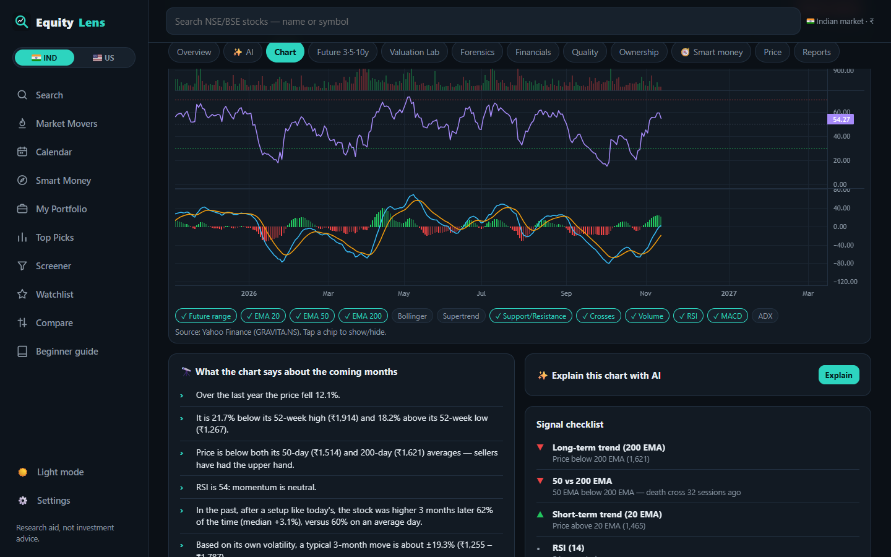
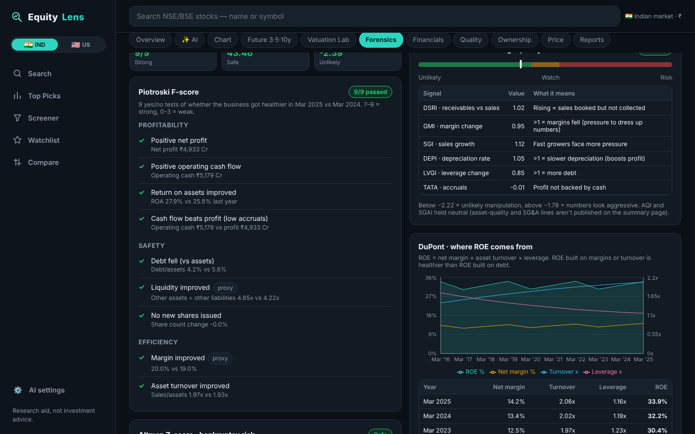
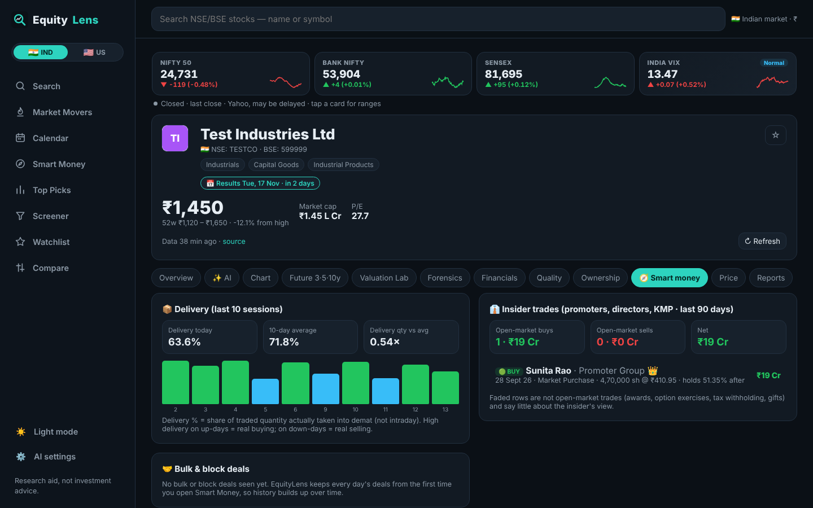
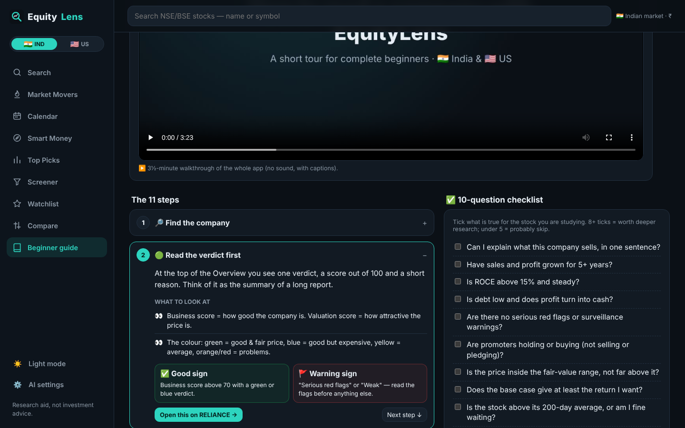
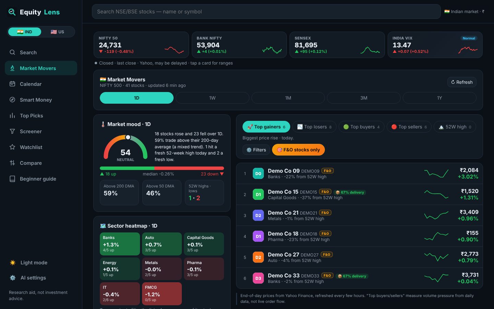
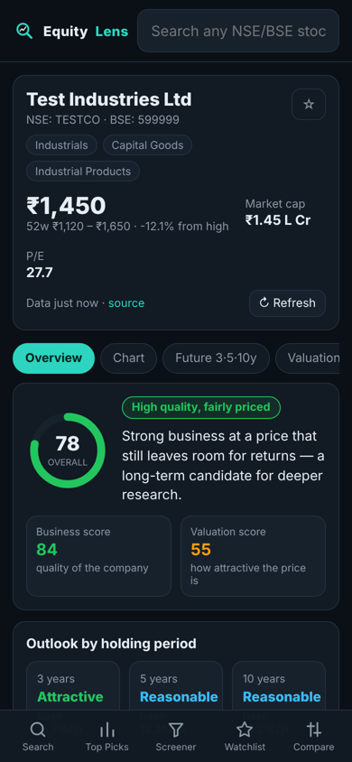
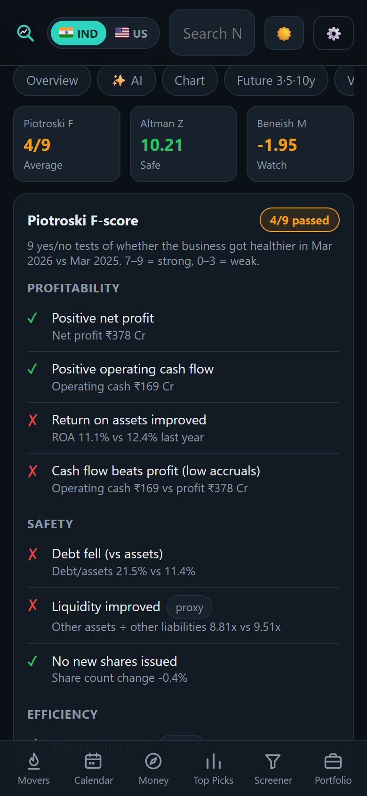
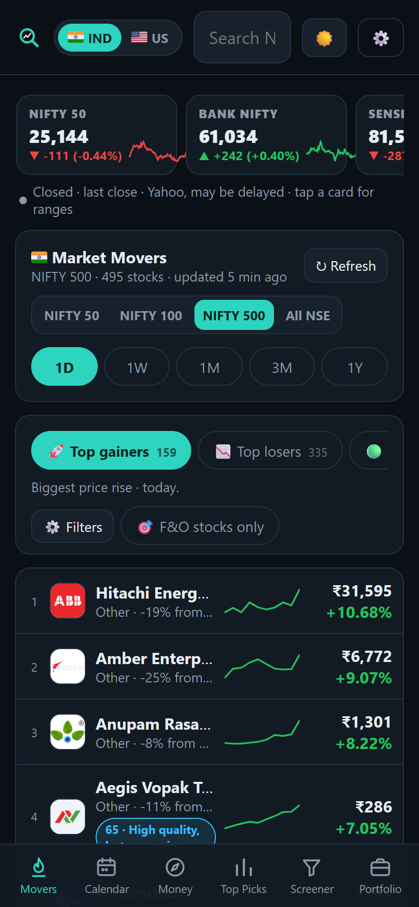
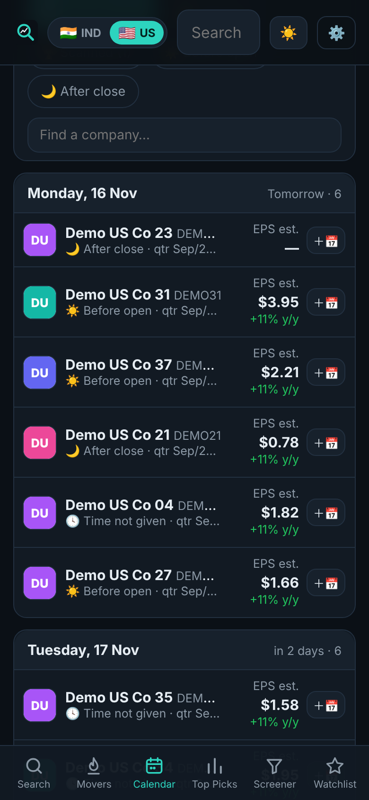
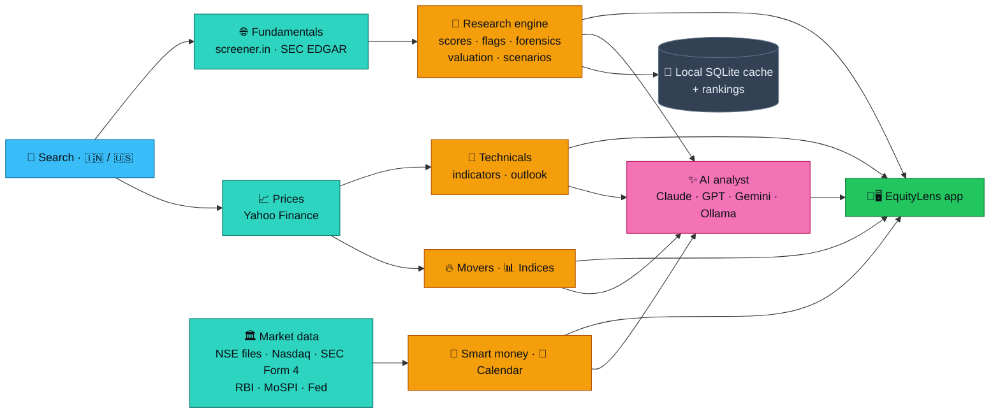

<div align="center">


<br/>


### Stock research for 🇮🇳 Indian and 🇺🇸 US markets — explained in plain English

**Search a company and get a complete report in seconds: a clear verdict, the reasons behind it, the risks,<br/>what the chart says next, and what has to go right over the next 3, 5 and 10 years.**

[What it does](#-what-it-does) · [Video](#-walkthrough-video) · [Screenshots](#-screenshots) · [Features](#-features) · [Getting started](#-getting-started) · [How it works](#-how-it-works) · [Data sources](#-data-sources)

</div>

---

## 💡 What it does

Most stock websites give you numbers. **EquityLens reads them for you.** It pulls 10+ years of financials, prices, filings and market data from free official sources, scores the business, checks the accounts for warning signs, values the stock several ways and writes up what it found — for any listed company in India or the US.

It runs on your own laptop, works on your phone, and needs **no paid data and no API keys** (an AI key is optional).

| | Area | In one line |
|:-:|---|---|
| 🔎 | **Stock report** | Verdict, 6 scores, red flags, forensics, valuation, 10-year story, 3/5/10-year scenarios, chart outlook |
| 📊 | **Market dashboard** | NIFTY · BANK NIFTY · SENSEX · VIX (or S&P 500 · NASDAQ · DOW · RUSSELL · VIX) on every page, plus market movers, mood and sector heatmap |
| 🧭 | **Smart money** | Delivery %, bulk & block deals, promoter / insider trades and exchange surveillance flags |
| 📅 | **Calendar** | Results and economic events with official dates, countdowns and what each one means |
| 🏆 | **Discovery** | Rank the whole NIFTY 500 / S&P 500, build your own screens, watchlist, compare |
| ✨ | **AI analyst** | Research notes, chat, bull-vs-bear debate, guidance check, report reader — with your choice of AI |
| 🎯 | **F&O stocks** | One switch turns every list into F&O stocks only; F&O badge and lot size on each stock |
| 📘 | **Beginner guide** | Learn to read a company in 10 minutes: 11 steps, a checklist, a glossary and a walkthrough video |

---

## 🎬 Walkthrough video

<a href="docs/equitylens_walkthrough.mp4"></a>

**[▶️ Watch the 3½-minute walkthrough](docs/equitylens_walkthrough.mp4)**: every step of reading a company, plus the daily market tools, with captions. The same video plays inside the app on the **📘 Beginner guide** page.

---

## 🆚 What makes it different

| | Typical free sites | **EquityLens** |
|---|:-:|:-:|
| **Research** | | |
| 10+ years of P&L, balance sheet, cash flow, quarters, shareholding | ✅ | ✅ |
| One clear **verdict** with the reasons, and 6 scores from 0 to 100 | ➖ | ✅ |
| **Red flags written out** — debt, weak cash conversion, promoter selling, pledging, dilution | ➖ | ✅ |
| **Forensic checks** — Piotroski F, Altman Z, Beneish M, DuPont | ➖ | ✅ |
| **3 / 5 / 10-year bear · base · bull** returns with every assumption visible, plus reverse DCF | ➖ | ✅ |
| **Valuation lab** — fair-value range from 5 methods, DCF sliders, sensitivity grid | ➖ | ✅ |
| **Chart outlook** — if/then levels, likely range, *what happened after the same setup before* | ➖ | ✅ |
| **Markets & money flow** | | |
| Gainers, losers, 52-week highs/lows, volume and most-active lists for 1D · 1W · 1M · 3M · 1Y | ✅ | ✅ |
| Buying / selling **pressure from volume**, **delivery %** and volume-confirmed breakouts | ➖ | ✅ |
| Price moves **joined with fundamentals** — *Quality on sale* and *Hype watch* | ➖ | ✅ |
| Promoter & insider trades with **cluster-buying** and pledge alerts (NSE + SEC Form 4) | ➖ | ✅ |
| **Exchange surveillance warnings** (GSM / ASM / ESM, insolvency, default, high pledge) on the stock page | ➖ | ✅ |
| **Calendar** | | |
| Results calendar with EPS estimates and timing | ✅ | ✅ |
| Results joined with **your watchlist and scores**, beat rate and price reaction | ➖ | ✅ |
| Economic calendar with **official RBI / MoSPI / Fed dates**, countdowns and *why it matters* | ➖ | ✅ |
| **Experience** | | |
| 🇮🇳 India and 🇺🇸 US in one app, same analysis for both | ➖ | ✅ |
| AI analyst with **your choice of provider** (Claude, ChatGPT, Gemini, or free local Ollama) | ➖ | ✅ |
| **3 signature scans** joining business quality, trend and money flow | ➖ | ✅ |
| 🎯 **F&O stocks only** switch across every list, with lot sizes | ➖ | ✅ |
| 📘 **Beginner guide** and walkthrough video built into the app | ➖ | ✅ |
| Phone and desktop layouts, light and dark theme, company logos | ✅ | ✅ |
| Runs on **your** machine — your data and keys stay with you | ➖ | ✅ |

<sub>➖ = not offered, or only partly, by most free sites.</sub>

---

## 📸 Screenshots

### 🖥️ Desktop


<table>
<tr>
<td align="center" width="50%"><br/><b>📈 Chart with indicators and the likely future range</b></td>
<td align="center" width="50%"><br/><b>🔭 Chart outlook and signal checklist</b></td>
</tr>
<tr>
<td align="center"><br/><b>💰 Valuation lab and peer ranking</b></td>
<td align="center"><br/><b>🕵️ Forensic checks</b></td>
</tr>
<tr>
<td align="center"><br/><b>🧭 Smart money: delivery, insider trades, deals</b></td>
<td align="center"><br/><b>🔥 Market movers, mood gauge and sector heatmap</b></td>
</tr>
<tr>
<td align="center"><br/><b>📅 Earnings calendar with countdown to the Fed</b></td>
<td align="center"><br/><b>🌐 Indian economic calendar with official dates</b></td>
</tr>
<tr>
<td align="center"><br/><b>✨ AI research note, chat and debate</b></td>
<td align="center"><br/><b>🏆 Top Picks ranking table</b></td>
</tr>
<tr>
<td align="center"><br/><b>🧮 Screener with the 3 signature scans</b></td>
<td align="center"><br/><b>📘 Beginner guide</b></td>
</tr>
<tr>
<td align="center"><br/><b>🎯 F&O stocks only</b></td>
<td align="center"><br/><b>☀️ Light theme</b></td>
</tr>
</table>

### 📱 Phone

<table>
<tr>
<td align="center" width="33%"><br/><b>Verdict and scores</b></td>
<td align="center" width="33%"><br/><b>What the chart says next</b></td>
<td align="center" width="33%"><br/><b>3 · 5 · 10-year outlook</b></td>
</tr>
<tr>
<td align="center"><br/><b>Valuation lab</b></td>
<td align="center"><br/><b>Forensics</b></td>
<td align="center"><br/><b>The 10-year story</b></td>
</tr>
<tr>
<td align="center"><br/><b>Market movers</b></td>
<td align="center"><br/><b>Delivery buying</b></td>
<td align="center"><br/><b>Promoter and insider trades</b></td>
</tr>
<tr>
<td align="center"><br/><b>Earnings calendar</b></td>
<td align="center"><br/><b>Economic events explained</b></td>
<td align="center"><br/><b>AI analyst</b></td>
</tr>
<tr>
<td align="center"><br/><b>🇺🇸 US stock from SEC filings</b></td>
<td align="center"><br/><b>Signature scans</b></td>
<td align="center"><br/><b>Beginner guide</b></td>
</tr>
</table>

<sub>Screenshots use the built-in sample companies (demo mode) so they look the same on every machine. Real stocks show live data and real company logos.</sub>

---

## 🧰 Features

### 🔎 Stock report

Search any company by name or symbol. Each stock page has these tabs:

| | Tab | What you get |
|:-:|---|---|
| 🟢 | **Overview** | Verdict and overall score · key ratios · latest quarter (YoY / QoQ) · strengths ✅ and red flags 🚩 · fair value and forensic quick checks · company key points · next results date |
| ✨ | **AI** | Research note · ask-anything chat · management guidance check · bull vs bear debate with a judge · annual report and concall reader |
| 📈 | **Chart** | Daily/weekly candles (3M–10Y) · EMA 20/50/200 · Bollinger · Supertrend · support/resistance · volume · RSI · MACD · ADX · signal checklist |
| 🔭 | **Chart outlook** | The chart's story in plain English · if/then price levels · likely price range drawn on the chart · what happened after the same setup in the past |
| 🔮 | **Future 3·5·10y** | Bear / base / bull price and yearly return · reverse DCF (*what growth does today's price already assume?*) · every assumption shown |
| 💰 | **Valuation Lab** | Fair-value range (DCF, Graham, own median P/E, peer P/E, justified P/B) · DCF sliders · sensitivity grid · P/E bands · peer ranking |
| 🕵️ | **Forensics** | Piotroski F-score (bank-adapted) · Altman Z · Beneish M · DuPont ROE breakdown · accounting checks |
| 📊 | **Financials** | 10-year story timeline · 10–12 years of P&L, balance sheet, cash flow, ratios and quarters with charts |
| 🏭 | **Quality** | ROCE trend · profit vs operating cash · free cash flow · working-capital days |
| 👥 | **Ownership** | Promoter / FII / DII / public holding, quarter by quarter |
| 🧭 | **Smart money** | 10-day delivery % · insider and promoter trades · bulk and block deals |
| 💹 | **Price** | 10-year price with 200-day average and price CAGR |
| 📄 | **Reports** | Annual reports, concall transcripts, presentations, announcements, credit ratings (10-K / 10-Q / 8-K for US) |

A **🚨 surveillance banner** appears at the top when the exchange is watching the stock, and a **📅 results badge** shows when the next results are due.

### 📊 Market dashboard

**Index card** — always at the top of the page, refreshed every minute:

| 🇮🇳 India | 🇺🇸 United States |
|---|---|
| NIFTY 50 · BANK NIFTY · SENSEX · INDIA VIX | S&P 500 · NASDAQ · DOW JONES · RUSSELL 2000 · VIX |

Each card shows the level, change, an intraday sparkline and (on tap) the day and 52-week range. The VIX card adds a plain-English fear level: *Calm · Normal · Nervous · Fear*.

**Market Movers** — the whole NIFTY 500 or S&P 500, for any timeframe from **1D to 1Y**:

| List | What it shows |
|---|---|
| 🚀 Top gainers · 📉 Top losers | Biggest rise / fall in the timeframe |
| 🟢 Top buyers · 🔴 Top sellers | Strongest buying / selling pressure, measured from up-day vs down-day volume. Tagged *only buyers / only sellers* when the stock closed at its high / low |
| 🏔️ 52W high · 🕳️ 52W low | New or near 52-week highs / lows; ✅ marks breakouts confirmed by volume |
| 🔊 Volume shockers · 💰 Most active | Unusual volume · highest traded value |
| 💎 Quality on sale | Strong businesses (score ≥ 70) trading 15%+ below their 52-week high |
| ⚠️ Hype watch | Fast risers with a weak business score or red flags |

Also on the page: a **market mood gauge** (extreme fear ↔ extreme greed) with a short explanation, a **sector heatmap**, filters (price, traded value, market cap, score, sector, 200-day trend, watchlist) and ✨ **Explain the move** with AI. Rows are tagged 📦 for heavy delivery and 🚨 for surveillance.

### 🧭 Smart money — who is really buying

| | Signal | What it tells you |
|:-:|---|---|
| 📦 | **Delivery buying / selling** 🇮🇳 | Price moved with delivery ≥ 50% and 1.5× the usual delivery quantity — real investors taking shares into demat, not intraday trading |
| 🤝 | **Bulk & block deals** 🇮🇳 | Which big investor bought or sold, how much and at what price; kept day by day for each stock |
| 👔 | **Insider & promoter trades** 🇮🇳 🇺🇸 | Promoters, directors and officers buying, selling or pledging. Open-market trades are highlighted; awards and option exercises are faded |
| ✅ | **Cluster buying** | Two or more insiders buying within 30 days — one of the stronger insider signals |
| 🚨 | **Surveillance flags** 🇮🇳 | GSM / ASM / ESM stages, insolvency, loan default, high pledge, loss-making 8+ quarters, BZ series, exit from F&O |

### 📅 Calendar

A week view with a day strip, for each market:

| | 🇮🇳 India | 🇺🇸 United States |
|---|---|---|
| 💼 **Results & events** | Results, dividends, bonus, splits, buybacks, fund raising, mergers (NSE board meetings) | Every company reporting: before open / after close, EPS estimate vs last year, then actual EPS and beat / miss |
| 🧾 **Week scorecard** | How many reported, how many rose after results, average reaction | How many reported, % that beat estimates, average reaction |
| 🌐 **Economy** | RBI policy, CPI, WPI, IIP, GDP, PMIs | Fed decisions, CPI, jobs, GDP, retail sales, ISM, jobless claims |
| 📌 **Official dates** | RBI MPC 10:00 AM · MoSPI CPI / IIP / GDP 4:00 PM · WPI 12:00 noon | Fed FOMC 2:00 PM ET |

- ⏳ **Countdown** to the next big events (RBI / Fed decision, CPI, GDP)
- 💡 Tap any event to see **what it is** and **why markets care**
- 🕓 Times shown in **your time zone** (a Fed decision at 2 PM ET is marked *next day* in India)
- ⭐ Your watchlist is pinned first; scanned stocks show their EquityLens score
- ＋📅 **Add to your phone, Google or Outlook calendar** with a reminder
- ✨ **Brief me on this week** — the AI explains which numbers and results matter

### 🧮 Screener and ⭐ signature scans

Three EquityLens signature scans sit at the top. Each one joins the **business**, the **price trend** and the **money flow**, and tells you what to check next:

| Scan | Finds | Why it works |
|---|---|---|
| 🚀 **Quality breakout** | Business score 65+, near a 52-week high, above its 50- and 200-day averages, no red flags | Good companies making new highs tend to keep leading |
| 🧭 **Smart-money accumulation** | Business score 60+ with delivery well above normal (🇮🇳) or insiders buying (🇺🇸) | Delivery and insider buying show conviction that price alone cannot |
| 💎 **Quality on sale** | Business score 70+, 15%+ below its high, still undervalued, Piotroski 6+ | Great businesses bought when the market is temporarily pessimistic |

Below them: 9 ready-made screens and your own rules on **55+ fields** — fundamentals, forensics, valuation, plus live fields (1W–1Y returns, 50/200-day trend, distance from high, relative volume, delivery %, insider buying, surveillance, F&O). Saved screens stay on your device.

### 🎯 F&O stocks

One **🎯 F&O stocks only** switch (India) filters Market Movers, Calendar, Smart Money, Screener and Top Picks together, and remembers your choice. Every F&O stock carries an **F&O** badge with its lot size, from NSE's official market-lots file.

### 📘 Beginner guide

For someone with zero stock-market knowledge: **11 steps** to read any company (each opens the right tab, with ✅ good signs and 🚩 warning signs), a **10-question checklist** that scores the stock as you tick, a **5-minute daily routine**, a **glossary** of 24 terms and the **walkthrough video**. Open it from the Home page or the sidebar.

### 🏆 Top Picks · ⭐ Watchlist · ⚖️ Compare

- **Top Picks** scans the whole NIFTY 500 or S&P 500 and ranks every company by the same rules; ✨ *explain this list* with AI
- **Watchlist** and **Compare** up to 4 stocks side by side

### ✨ AI analyst

| Agent | What it does |
|---|---|
| 🧠 Research note | Full write-up: quality, growth, balance sheet, forensics, valuation, 3/5/10-year view, risks, what to watch |
| 💬 Ask about this stock | Chat grounded in that stock's own data — *"Is the debt a worry?"*, *"Why did margins fall?"* |
| 🎯 Guidance check | Grades each management target against the company's track record: achievable · stretch · unlikely |
| ⚔️ Bull vs bear | Two agents argue each side; a judge checks both against the data |
| 📄 Report reader | Reads annual reports and concall transcripts: guidance, capex, risks, tone |
| 📈 Chart explainer · 🔥 Explain the move · 📅 Weekly brief · 🏆 Explain my list | Plain-English explanations of charts, market moves, the calendar and ranked lists |

| Provider | Cost | Notes |
|---|---|---|
| **Claude** | Pay per use | Best for long reports |
| **ChatGPT** | Pay per use | Any chat model on your OpenAI account |
| **Gemini** | Free tier + paid | *Load my models* lists what your key can use |
| **Ollama** | Free | Runs locally on your laptop |
| **Demo** | Free | Offline sample answers |

> [!IMPORTANT]
> The AI sees only EquityLens's data for that stock and is instructed never to invent numbers. API keys are stored on your laptop only (`backend/data/ai_settings.json` or `backend/.env`, both git-ignored).

### 🇮🇳 / 🇺🇸 Two markets, one app

Tap **🇮🇳 IND** or **🇺🇸 US** at the top. Search, movers, calendar, smart money, Top Picks and the screener all switch to that market.

| | 🇮🇳 India | 🇺🇸 United States |
|---|---|---|
| Stocks | NSE and BSE | NYSE and Nasdaq (every SEC filer) |
| Amounts | ₹ crore | US$ million |
| Index scans | NIFTY 500 | S&P 500 |
| Ownership | Promoter / FII / DII trend | Not reported the same way, so not scored |

---

## 🚀 Getting started

### Requirements

- Windows 10/11 (macOS / Linux work with the manual steps)
- [Python 3.11+](https://www.python.org/downloads/)
- Internet connection
- *Optional:* an AI key (Claude, OpenAI or Gemini) or [Ollama](https://ollama.com) · [Tailscale](https://tailscale.com) to open it on your phone · Node.js only if you want to change the frontend

### Install and run

> [!TIP]
> **One click:** double-click **`start.bat`**. The first run creates a virtual environment, installs 6 small packages and opens **http://localhost:8600**.

```bat
git clone https://github.com/dhanunjaya-kd/equitylens
cd equitylens
start.bat
```

<details>
<summary><b>Manual setup</b></summary>

```bat
cd backend
py -3.11 -m venv venv
venv\Scripts\activate
pip install -r requirements.txt
python selftest.py
python run.py
```
</details>

### First steps

| # | Step | Why |
|:-:|---|---|
| 1 | Copy `backend/.env.example` to `backend/.env` and set `EQL_SEC_USER_AGENT` to your name and email | The SEC requires it for US data (sent only to sec.gov) |
| 2 | Run `python selftest.py` in `backend/` | Checks every live source end to end and prints exactly what was read |
| 3 | New to stocks? Open **📘 Beginner guide** | 11 steps, a checklist and the walkthrough video |
| 4 | Search any stock | Full report in about 5 seconds, cached for 24 hours (↻ Refresh fetches new data) |
| 5 | ⚙️ Settings → choose an AI provider | Optional: Claude, ChatGPT, Gemini, or free local Ollama |
| 6 | Top Picks → **Quick scan (30)**, later **Scan NIFTY 500 / S&P 500** | Builds the rankings used by Top Picks, the screener and the *Quality on sale* list (full scan ≈ 30–60 min; re-run weekly) |
| 7 | Open **Movers**, **Calendar** and **Money** once | First load downloads the index's daily prices and NSE files (a few minutes); after that they refresh in the background |

### Use on laptop and phone

- **Laptop:** open **http://localhost:8600**. Screens wider than ~1100 px get the desktop layout with a sidebar and multi-column pages.
- **Phone:** keep the laptop on with Tailscale running, open `http://<laptop-tailscale-ip>:8600`, then **Share → Add to Home Screen** to use it like an app. On the phone, search is in the top bar and the logo takes you home.

<details>
<summary><b>⚙️ Configuration (<code>backend/.env</code>)</b></summary>

| Variable | Default | What it does |
|---|---|---|
| `EQL_SEC_USER_AGENT` | — | Your name and contact for SEC EDGAR (required for US stocks) |
| `EQL_AI_PROVIDER` | `claude` | `claude` · `openai` · `gemini` · `ollama` · `demo` |
| `EQL_REQUIRED_RETURN` | `0.12` | Target yearly return used in reverse DCF and the default DCF |
| `EQL_FAIR_EXIT_PE` | `20` | Exit P/E for reverse DCF |
| `EQL_CACHE_TTL_HOURS` | `24` | How long a fetched stock is reused |
| `EQL_SCAN_DELAY` | `3` | Seconds between companies in a scan (keeps requests polite) |
| `EQL_PORT` | `8600` | Web port |
| `EQL_DEMO` | `0` | `1` = offline demo with sample companies **TESTCO**, **TESTBANK** and 🇺🇸 **TSTUS** |

AI keys and model names: see `backend/.env.example`, or set them in ⚙️ Settings.
</details>

---

## 🧭 How it works



A single Python process (FastAPI) fetches the data, analyses it, caches it in a local SQLite file and serves the prebuilt React app. Every source is fetched politely (paced, retried, cached), and one failing source never breaks the rest of the page.

### Verdicts

| | Verdict | Meaning |
|:-:|---|---|
| 🟢 | **High quality, fairly priced** | Strong business; the price still leaves room for returns |
| 🔵 | **High quality, but expensive** | Great business; the price already expects a lot |
| 🟡 | **Average — keep on watch** | Mixed picture worth tracking |
| 🟠 | **Good numbers, serious red flags** | Check the flags before trusting the scores |
| 🔴 | **Weak — avoid for now** | Fundamentals or red flags argue against holding |
| ⚫ | **Loss-making — speculative** | No current earnings; a turnaround bet |
| ⚪ | **Not enough data** | Under 3 years of usable numbers: not rated, not ranked |

<details>
<summary><b>📐 Scoring and scenario rules</b> (also visible inside the app)</summary>

<br/>

| Score (0–100) | Built from |
|---|---|
| 🌱 Growth | 5-year profit and sales CAGR, years of profit growth |
| 🏭 Quality | 5-year average ROCE (ROE for banks), margin stability |
| 🛡️ Strength | Debt/equity, interest coverage (equity/assets for banks) |
| 💵 Cash | Operating cash ÷ profit, free-cash years (skipped for banks) |
| 👥 Ownership | Promoter level and trend, FII + DII trend, pledging |
| 🏷️ Valuation | P/E, PEG, P/E vs its own 10-year median, P/B for banks |

**Business score** = growth 28% + quality 28% + strength 17% + cash 17% + ownership 10% · **Overall** = 80% business + 20% valuation.

**Future scenarios:** start from last-12-month EPS → grow at a blend of 3/5/10-year profit growth (capped at sales growth + 5 points and at 25%) → growth fades to 4 / 8 / 11% by year 10 (bear / base / bull) → P/E starts at its 10-year median and drifts toward 12–25. Returns include the dividend yield.

**Chart outlook:** the likely range uses the stock's own past-year volatility with no direction assumed. *Same setup before* finds every past day with the same trend and momentum state (price vs 200 EMA, 50 vs 200 EMA, RSI zone, MACD vs signal) and measures the price 1, 3 and 6 months later against an average day.

**Market mood:** average of advances vs declines, % of stocks above their 50- and 200-day averages, stocks near 52-week highs vs lows, and the median move.
</details>

---

## 🌐 Data sources

All free and public. No logins, no paid feeds.

| Data | 🇮🇳 India | 🇺🇸 United States |
|---|---|---|
| Financials (10+ years) | screener.in public company pages | SEC EDGAR XBRL filings (10-K / 10-Q) |
| Prices, charts, indices | Yahoo Finance public chart feed | Yahoo Finance public chart feed |
| Index lists | NIFTY 500 (niftyindices.com) | S&P 500 constituents |
| F&O stocks and lot sizes | NSE F&O market-lots file | — |
| Delivery % | NSE daily bhavcopy with deliverable quantity | — |
| Bulk & block deals | NSE bulk / block deal files | — |
| Insider trades | NSE insider-trading (SEBI PIT) disclosures | SEC Form 4 |
| Surveillance flags | NSE surveillance indicator file (REG_IND) | — |
| Results calendar | NSE event calendar (board meetings) | Nasdaq earnings calendar |
| Economic calendar | Nasdaq economic calendar + RBI, MoSPI and DPIIT official schedules | Nasdaq economic calendar + Federal Reserve FOMC schedule |
| Documents | Annual reports, concalls, announcements (company page) | 10-K, 10-Q, 8-K (SEC) |
| Logos | Financial Modeling Prep public logo images, or the company's website icon | same |

If a source changes its format, `python selftest.py` shows exactly which part broke.

---

## 🧪 Quality and testing

```bat
cd backend
python run_tests.py
```

72 offline tests run against saved copies of each source's real format, so they pass without internet:

| Suite | Covers |
|---|---|
| `test_engine.py` | Parsing, scores, flags, forensics, valuation and indicator maths (EMA, RSI, MACD, ADX checked against reference formulas) |
| `test_stress.py` | 12 broken or partial-data cases (no cash flow, 2 years only, negative equity, all losses, no price…) never crash and are never over-rated |
| `test_us.py` | SEC filings: revenue tag changes merged, year-to-date figures ignored, Q4 derived, TTM, ratios |
| `test_movers.py` | Returns per timeframe, buying/selling pressure, turnover, relative volume, 52-week breakouts, mood, sector heatmap |
| `test_flows.py` | NSE delivery, deals, insider and surveillance formats; SEC Form 4; cluster and net-buying maths |
| `test_enrich.py` | NSE F&O market-lots file, live trend / delivery / insider / surveillance fields joined onto every list |
| `test_calendar.py` | Nasdaq and NSE calendar formats, official RBI / MoSPI / WPI / FOMC dates and IST / ET times, de-duplication, logos |
| `test_indices.py` | Index quotes, change maths, market open/closed, VIX bands |
| `test_ai.py` | Exact request formats for Claude, OpenAI, Gemini and Ollama; error handling; masked keys |
| `test_api.py` | Every endpoint, including error paths |

---

## 🗂️ Project structure

```
equitylens/
├── start.bat                 one-click start (Windows)
├── backend/
│   ├── app/
│   │   ├── main.py           API + serves the web app
│   │   ├── service.py        fetch → cache → analyse, index scans
│   │   ├── scraper.py        🇮🇳 company pages (paced, retried, cached)
│   │   ├── parser.py         HTML → clean tables, key points, peers, documents
│   │   ├── us.py             🇺🇸 SEC EDGAR → the same tables
│   │   ├── analysis.py       metrics, scores, flags, scenarios, verdict, 10-year story
│   │   ├── forensics.py      Piotroski · Altman · Beneish · DuPont
│   │   ├── valuation.py      DCF · Graham · P/E bands · EV · fair value
│   │   ├── technicals.py     indicators + chart outlook
│   │   ├── movers.py         market movers, pressure, mood, sector heatmap
│   │   ├── indices.py        index card quotes and VIX bands
│   │   ├── flows.py          delivery, deals, insider trades, surveillance, Form 4
│   │   ├── calendars.py      results and economic calendars, official schedules
│   │   ├── enrich.py         F&O list + live fields joined onto every list
│   │   ├── logos.py          company logos with initials fallback
│   │   ├── ai.py             Claude / OpenAI / Gemini / Ollama agents
│   │   ├── money.py · store.py · universe.py · config.py
│   ├── static/               prebuilt web app (no Node.js needed to run)
│   ├── tests/                72 offline tests + sample data
│   └── run.py · selftest.py · run_tests.py · scan.py
├── frontend/                 React + Vite source (npm install && npm run build)
└── docs/                     banner, screenshots and the walkthrough video
```

<details>
<summary><b>API reference</b></summary>

| Endpoint | Purpose |
|---|---|
| `GET /api/search?q=&market=` | Find a company |
| `GET /api/stock/{symbol}` · `GET /api/chart/{symbol}` | Full report · chart data and outlook |
| `GET /api/compare?symbols=` | Up to 4 reports side by side |
| `GET /api/rankings` · `POST /api/scan/start` | Rankings · start an index scan |
| `GET /api/movers?market=&tf=` | Market movers, mood and sectors |
| `GET /api/indices?market=` | Index card |
| `GET /api/flows/stock/{symbol}` | Delivery, deals, insiders and surveillance for one stock |
| `GET /api/flows/delivery` · `deals` · `insiders` · `surveillance` | Market-wide smart-money lists |
| `GET /api/calendar/earnings` · `economy` · `next/{symbol}` | Calendars and next results date |
| `POST /api/ai/{note,chat,guidance,debate,doc,chart}/{symbol}` | AI features for a stock |
| `POST /api/ai/{picks,movers,calendar}` | AI explanations of lists, moves and the week |
| `GET /api/fno` | F&O stocks and lot sizes |
| `GET /api/logo/{symbol}` | Company logo |

`symbol` is the NSE symbol (e.g. `RELIANCE`) or `US:` + ticker (e.g. `US:AAPL`).
</details>

---

## 🛣️ Roadmap

- [ ] 🔔 Telegram alerts and a morning digest: watchlist results, big economic events, 52-week breakouts, verdict changes
- [ ] 🧾 Results-day analyser: new quarter vs estimates and vs the 3/5/10-year assumptions
- [ ] 💼 Portfolio X-ray: import holdings, see combined score, concentration and red flags
- [ ] ☁️ Cloud version so it works with the laptop off
- [ ] 📈 Score track record: monthly snapshots to check whether high scores beat low scores

---

> [!NOTE]
> Keep EquityLens on your own network (for example with Tailscale) rather than exposing port 8600 to the internet, because Settings can change AI keys.

> [!WARNING]
> Everything is built from **past numbers and stated assumptions**. EquityLens is a research aid, **not investment advice**. Read the red flags and the company's own reports before investing.

<div align="center">
<br/>

Made with 💚 for long-term investing

</div>
