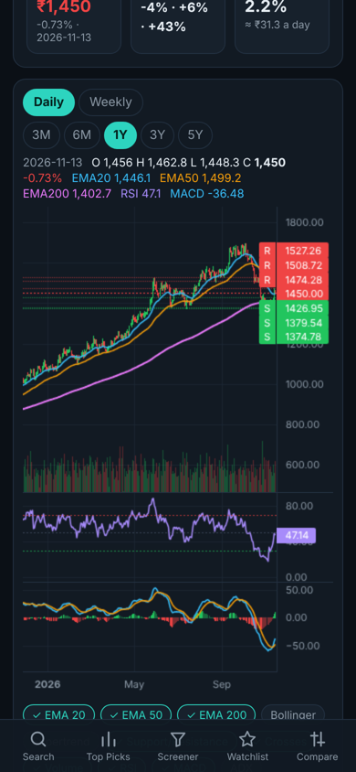
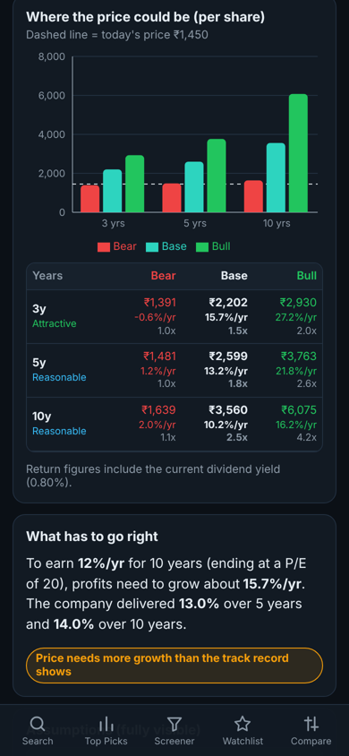
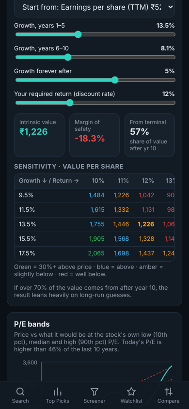
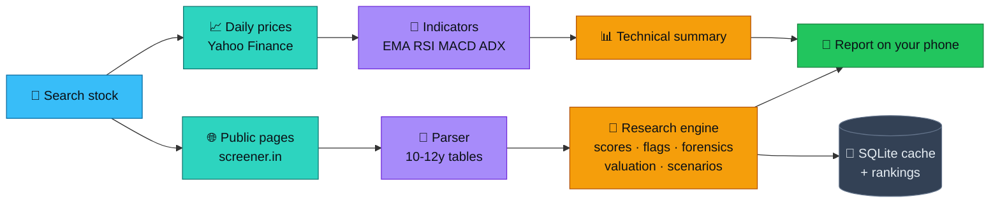

<div align="center">


<br/>


### 🔎 Search any Indian stock → get a complete research report in seconds

**10+ years of financials · 6 scores · red flags · forensic checks · fair value · 3/5/10-year outlook · technical chart**

</div>

---

## 📸 Screenshots

<table>
<tr>
<td align="center"><br/><b>🟢 Overview & verdict</b></td>
<td align="center"><br/><b>📈 Technical chart</b></td>
<td align="center"><br/><b>🔮 3 · 5 · 10-year outlook</b></td>
</tr>
<tr>
<td align="center"><br/><b>💰 Valuation Lab (live DCF)</b></td>
<td align="center"><br/><b>🕵️ Forensics</b></td>
<td align="center"><br/><b>🧮 Screener</b></td>
</tr>
</table>

<sub>Screenshots use the built-in sample company (demo mode). Real stocks look the same with live numbers.</sub>

---

## ✨ What you get

| | Tab | What's inside |
|:-:|---|---|
| 🟢 | **Overview** | Verdict, overall score ring, 3/5/10-year stance, scorecard, strengths ✅ & red flags 🚩, quick checks |
| 📈 | **Chart** | Candles (daily/weekly, 3M–10Y) · EMA 20/50/200 · Bollinger · Supertrend · golden/death crosses · support/resistance · Volume · RSI · MACD · ADX · signal checklist |
| 🔮 | **Future 3·5·10y** | Bear / base / bull price and yearly return · reverse DCF ("what growth does today's price need?") · every assumption visible |
| 💰 | **Valuation Lab** | Fair-value range from 5 methods · **DCF with sliders** · sensitivity grid · P/E bands · Graham number · EV/EBITDA · peers |
| 🕵️ | **Forensics** | **Piotroski F** (9 health tests) · **Altman Z** (bankruptcy risk) · **Beneish M** (earnings manipulation) · **DuPont** ROE breakdown · accounting checks |
| 📊 | **Financials** | 10–12 years of P&L, balance sheet, cash flow, ratios, quarterly results, with charts |
| 🏭 | **Quality** | ROCE trend, profit vs operating cash, free cash, working-capital days |
| 👥 | **Ownership** | Promoter / FII / DII / public trend, quarter by quarter |
| 📄 | **Reports** | Annual reports, concall transcripts & PPTs, announcements, credit ratings |

### 🏆 Top Picks &nbsp;·&nbsp; 🧮 Screener &nbsp;·&nbsp; ⭐ Watchlist &nbsp;·&nbsp; ⚖️ Compare

- 🏆 **Top Picks:** scans the whole **NIFTY 500** and ranks every company by the same rules
- 🧮 **Screener:** 9 ready-made screens plus your own rules on **45+ fields**, saved on your phone
  > 💎 Quality compounders · 🏷️ Value with quality · 📉 Below fair value · 🏦 Holding-company discount · 🧱 Debt-free growers · 🚀 Piotroski 8+ · 🤝 Promoters buying · ⏳ Cheap vs own history · 🌳 10-year compounders
- ⭐ **Watchlist** and ⚖️ **Compare up to 4 stocks** side by side

---

## 🚀 Quick start (Windows)

> [!TIP]
> **One click:** double-click **`start.bat`**. The first run creates `backend/venv`, installs 5 small packages and opens **http://localhost:8600** in your browser.

```bat
git clone https://github.com/dhanunjaya-kd/equitylens
cd equitylens
start.bat
```

<details>
<summary>🛠️ <b>Manual setup</b></summary>

```bat
cd backend
py -3.11 -m venv venv
venv\Scripts\activate
pip install -r requirements.txt
REM run once: checks live data end to end
python selftest.py
python run.py
```
</details>

### ✅ First things to do

| # | Do this | Why |
|:-:|---|---|
| 1️⃣ | `python selftest.py` in `backend/` | Fetches RELIANCE, HDFCBANK, ITC live and prints what was read |
| 2️⃣ | Search any stock in the app | Full report in ~5 s, cached for 24 h (↻ Refresh fetches new data) |
| 3️⃣ | Top Picks → **Quick scan (30)** | See the ranking work in ~3 min |
| 4️⃣ | Top Picks → **Scan NIFTY 500** (or `python scan.py`) | Full ranking in ~40–60 min. Re-run weekly or after results season |

### 📱 Use it on your phone

1. Keep the laptop on with Tailscale running
2. On the iPhone open `http://<laptop-tailscale-ip>:8600`
3. Share → **Add to Home Screen** and it opens like an app

---

## 🧭 How it works



### 🚦 Verdicts

| | Verdict | Meaning |
|:-:|---|---|
| 🟢 | **High quality, fairly priced** | Strong business, price still leaves room for returns |
| 🔵 | **High quality, but expensive** | Great business, price already expects a lot |
| 🟡 | **Average — keep on watch** | Mixed picture, track it |
| 🟠 | **Good numbers, serious red flags** | Check the flags before trusting the scores |
| 🔴 | **Weak — avoid for now** | Fundamentals or red flags argue against holding |
| ⚫ | **Loss-making — speculative** | No current earnings, a turnaround bet |

<details>
<summary>📐 <b>Scoring rules (all visible in the app)</b></summary>

<br/>

| Score (0–100) | Built from |
|---|---|
| 🌱 Growth | 5-yr profit & sales CAGR, years of profit growth |
| 🏭 Quality | ROCE 5-yr average (ROE for banks), margin stability |
| 🛡️ Strength | Debt/equity, interest coverage (equity/assets for banks) |
| 💵 Cash | Operating cash ÷ profit, free-cash years (skipped for banks) |
| 👥 Ownership | Promoter level & trend, FII+DII trend, pledging |
| 🏷️ Valuation | P/E, PEG, P/E vs own 10-yr median, P/B for banks |

**Business** = first five · **Overall** = 80% business + 20% valuation

**Future scenarios:** start from last-12-month EPS → grow at a blend of 3/5/10-yr profit growth (capped at sales growth + 5 and at 25%) → growth fades to 4 / 8 / 11% by year 10 (bear / base / bull) → P/E starts at the 10-yr median and drifts toward 12–25. Returns include the dividend yield.
</details>

<details>
<summary>⚙️ <b>Settings (environment variables)</b></summary>

| Variable | Default | What it does |
|---|---|---|
| `EQL_REQUIRED_RETURN` | `0.12` | Target yearly return used in reverse DCF and default DCF |
| `EQL_FAIR_EXIT_PE` | `20` | Exit P/E for reverse DCF |
| `EQL_CACHE_TTL_HOURS` | `24` | How long a fetched stock is reused |
| `EQL_SCAN_DELAY` | `3` | Seconds between companies in a scan (keep it polite) |
| `EQL_PORT` | `8600` | Web port |
| `EQL_DEMO` | `0` | `1` = offline demo with sample companies **TESTCO** and **TESTBANK** |
</details>

---

## 🗂️ Project structure

```
equitylens/
├── 🟦 start.bat              one-click start (Windows)
├── 🐍 backend/
│   ├── app/
│   │   ├── scraper.py        public-page fetcher (paced, retries, cached)
│   │   ├── parser.py         HTML → clean tables, peers, documents
│   │   ├── analysis.py       metrics, scores, flags, scenarios, verdict
│   │   ├── forensics.py      Piotroski · Altman · Beneish · DuPont
│   │   ├── valuation.py      DCF · Graham · P/E bands · EV · fair value
│   │   ├── technicals.py     OHLC + EMA · RSI · MACD · ADX · Supertrend · BB
│   │   ├── service.py        fetch → cache → analyse, NIFTY 500 scan
│   │   └── main.py           API + serves the web app
│   ├── static/               prebuilt app (no npm needed to run)
│   ├── tests/                offline tests + sample company pages
│   └── run.py · scan.py · selftest.py
├── ⚛️ frontend/              React source (npm install && npm run build)
└── 🖼️ docs/                  banner + screenshots
```

---

> [!NOTE]
> Fundamentals come from the same public company pages you'd open in a browser (screener.in), and chart prices from Yahoo Finance's public chart feed. No logins or paid data. If a site changes its layout, `selftest.py` shows exactly which section broke.

> [!WARNING]
> Everything is built from **past numbers and stated assumptions**. EquityLens is a research aid, **not investment advice**. Read the red flags and the company's own annual report before investing.

<div align="center">
<br/>

Made with 💚 for long-term investing

</div>
