<div align="center">


<br/>


### Stock research for 🇮🇳 Indian and 🇺🇸 US markets — explained in plain English

**Search a company and get a complete report in seconds: a clear verdict, the reasons behind it, the risks,<br/>what the chart says next, and what has to go right over the next 3, 5 and 10 years.**

[What it does](#-what-it-does) · [Video](#-walkthrough-video) · [Screenshots](#-screenshots) · [Features](#-features) · [Getting started](#-getting-started) · [How it works](#-how-it-works) · [Data sources](#-data-sources)

</div>

---

## 💡 What it does

Most stock websites give you numbers. **EquityLens reads them for you.** It pulls 10+ years of financials, prices, filings and market data from free official sources, scores the business, checks the accounts for warning signs, values the stock several ways and writes up what it found — for any listed company in India or the US.

It runs on your own laptop, works on your phone, and needs **no paid data and no API keys** (an AI key is optional).

| | Area | In one line |
|:-:|---|---|
| 🔎 | **Stock report** | Verdict, 6 scores, red flags, forensics, valuation, 10-year story, 3/5/10-year scenarios, chart outlook |
| 🌅 | **Pre-market** | Before 09:15: overnight US, Asia, crude, gold, silver, Bitcoin, rupee, yields and FII / DII flows, each marked positive or negative for NIFTY, plus a NIFTY opening call with its real backtested and live track record |
| 🚦 | **Entry decision** | *Enter now* or *Avoid for now* for a 1–3 year holding, from fixed rules tested on 10 years of NSE data, with the rule's real track record and AI research on every stock |
| 📊 | **Market dashboard** | NIFTY · BANK NIFTY · SENSEX · VIX (or S&P 500 · NASDAQ · DOW · RUSSELL · VIX) on every page, plus market movers, mood and sector heatmap |
| 🧭 | **Smart money** | Delivery %, bulk & block deals, promoter / insider trades and exchange surveillance flags |
| 📅 | **Calendar** | Results and economic events with official dates, countdowns and what each one means |
| 🏆 | **Discovery** | Rank the whole NIFTY 500 / S&P 500, build your own screens, watchlist, compare |
| ✨ | **AI analyst** | Entry research, research notes, chat, bull-vs-bear debate, guidance check, report reader — with your choice of AI |
| 🏛️ | **Stock lists** | NIFTY 50 · NIFTY 100 · NIFTY 500 · All NSE — one choice applies to every list and to scans |
| 🎯 | **F&O stocks** | One switch turns every list into F&O stocks only; F&O badge and lot size on each stock |
| 📘 | **Beginner guide** | Learn to read a company in 10 minutes: 11 steps, a checklist, a glossary and a walkthrough video |

---

## 🎬 Walkthrough video

<a href="docs/equitylens_walkthrough.mp4">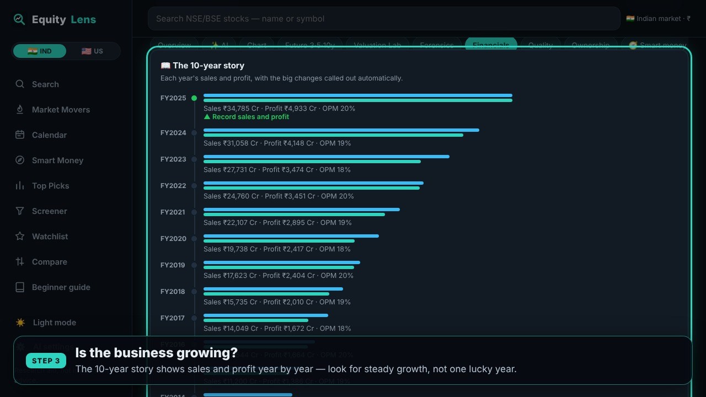</a>

**[▶️ Watch the 4-minute walkthrough](docs/equitylens_walkthrough.mp4)**, filmed with live data on a real 🇮🇳 company (**Gravita India**) and a real 🇺🇸 company (**Apple**): every step of reading a company, plus the daily market tools, with captions. The same video plays inside the app on the **📘 Beginner guide** page.

To film it again with real companies and live data on your own laptop: `python tools\make_video.py --india GRAVITA --us US:AAPL` (see the top of that file for the two packages it needs).

---

## 🆚 What makes it different

| | Typical free sites | **EquityLens** |
|---|:-:|:-:|
| **Research** | | |
| 10+ years of P&L, balance sheet, cash flow, quarters, shareholding | ✅ | ✅ |
| One clear **verdict** with the reasons, and 6 scores from 0 to 100 | ➖ | ✅ |
| **Red flags written out** — debt, weak cash conversion, promoter selling, pledging, dilution | ➖ | ✅ |
| **Forensic checks** — Piotroski F, Altman Z, Beneish M, DuPont | ➖ | ✅ |
| **3 / 5 / 10-year bear · base · bull** returns with every assumption visible, plus reverse DCF | ➖ | ✅ |
| **Valuation lab** — fair-value range from 5 methods, DCF sliders, sensitivity grid | ➖ | ✅ |
| **Chart outlook** — if/then levels, likely range, *what happened after the same setup before* | ➖ | ✅ |
| **Markets & money flow** | | |
| Gainers, losers, 52-week highs/lows, volume and most-active lists for 1D · 1W · 1M · 3M · 1Y | ✅ | ✅ |
| Buying / selling **pressure from volume**, **delivery %** and volume-confirmed breakouts | ➖ | ✅ |
| Price moves **joined with fundamentals** — *Quality on sale* and *Hype watch* | ➖ | ✅ |
| Promoter & insider trades with **cluster-buying** and pledge alerts (NSE + SEC Form 4) | ➖ | ✅ |
| **Exchange surveillance warnings** (GSM / ASM / ESM, insolvency, default, high pledge) on the stock page | ➖ | ✅ |
| **Calendar** | | |
| Results calendar with EPS estimates and timing | ✅ | ✅ |
| Results joined with **your watchlist and scores**, beat rate and price reaction | ➖ | ✅ |
| Economic calendar with **official RBI / MoSPI / Fed dates**, countdowns and *why it matters* | ➖ | ✅ |
| **Experience** | | |
| 🇮🇳 India and 🇺🇸 US in one app, same analysis for both | ➖ | ✅ |
| AI analyst with **your choice of provider** (Claude, ChatGPT, Gemini, or free local Ollama) | ➖ | ✅ |
| **3 signature scans** joining business quality, trend and money flow | ➖ | ✅ |
| 🎯 **F&O stocks only** switch across every list, with lot sizes | ➖ | ✅ |
| 🏛️ **NIFTY 50 / 100 / 500 / All NSE** choice shared by movers, calendar, smart money, screener and scans | ➖ | ✅ |
| 📘 **Beginner guide** and walkthrough video built into the app | ➖ | ✅ |
| Phone and desktop layouts, light and dark theme, company logos | ✅ | ✅ |
| Runs on **your** machine — your data and keys stay with you | ➖ | ✅ |

<sub>➖ = not offered, or only partly, by most free sites.</sub>

---

## 📸 Screenshots

All screenshots are taken with live data on a real 🇮🇳 company (**Gravita India**) and a real 🇺🇸 company (**Apple**). To take them again on your own laptop: `python tools\make_screenshots.py` in `backend/` (add `--india TCS --us US:MSFT` for other companies).

### 🖥️ Desktop


<table>
<tr>
<td align="center" width="50%">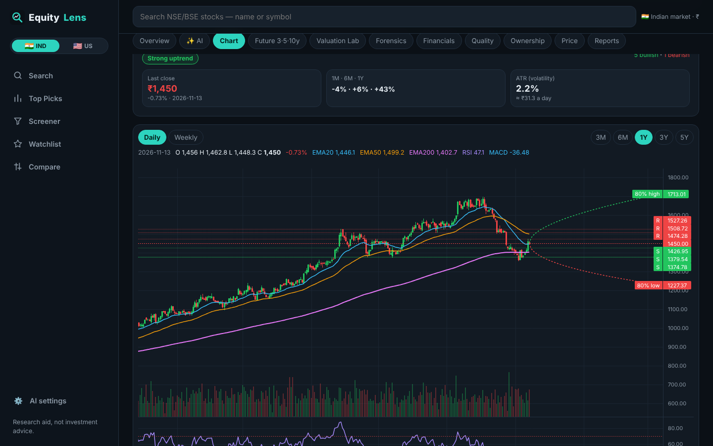<br/><b>📈 Chart with indicators and the likely future range</b></td>
<td align="center" width="50%"><br/><b>🔭 Chart outlook and signal checklist</b></td>
</tr>
<tr>
<td align="center">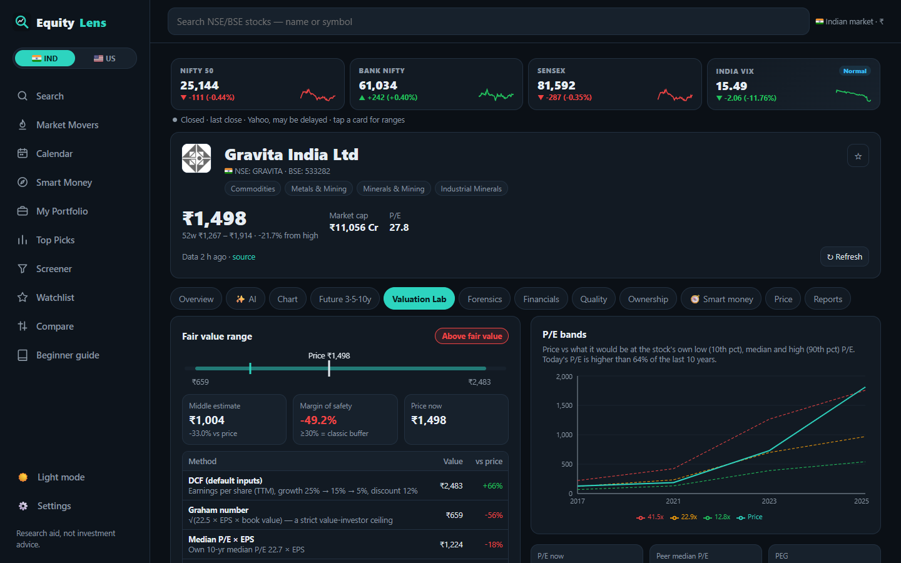<br/><b>💰 Valuation lab and peer ranking</b></td>
<td align="center"><br/><b>🕵️ Forensic checks</b></td>
</tr>
<tr>
<td align="center"><br/><b>🧭 Smart money: delivery, insider trades, deals</b></td>
<td align="center"><br/><b>🔥 Market movers, mood gauge and sector heatmap</b></td>
</tr>
<tr>
<td align="center">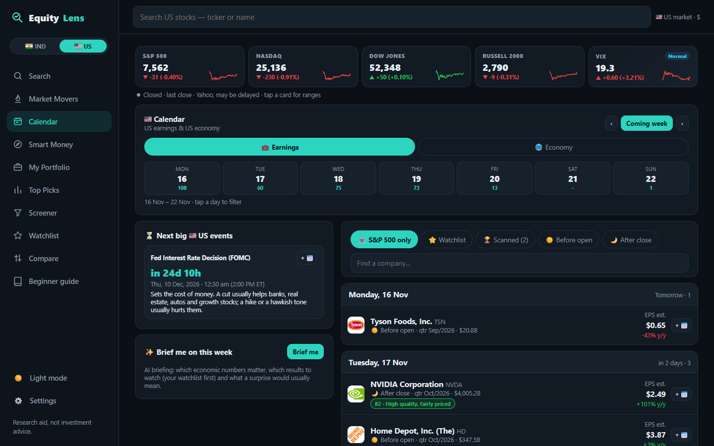<br/><b>📅 Earnings calendar with countdown to the Fed</b></td>
<td align="center">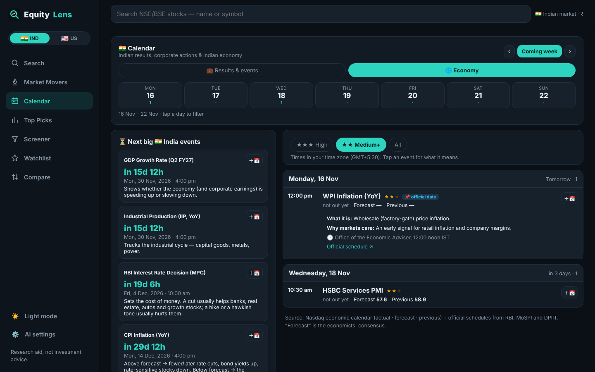<br/><b>🌐 Indian economic calendar with official dates</b></td>
</tr>
<tr>
<td align="center">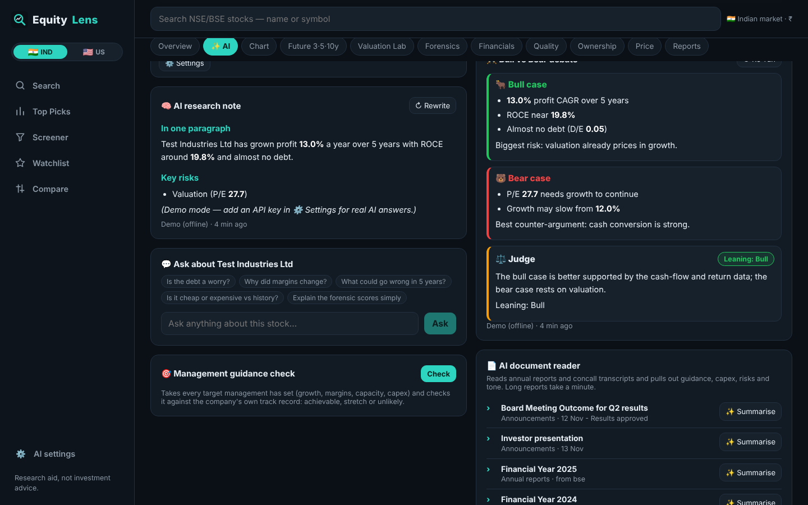<br/><b>✨ AI research note, chat and debate</b></td>
<td align="center">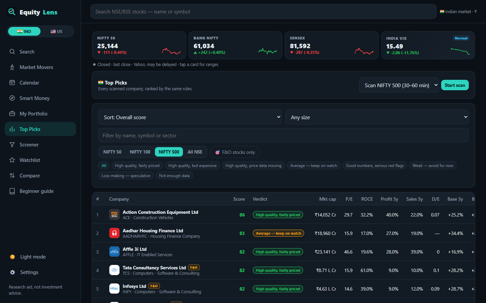<br/><b>🏆 Top Picks ranking table</b></td>
</tr>
<tr>
<td align="center">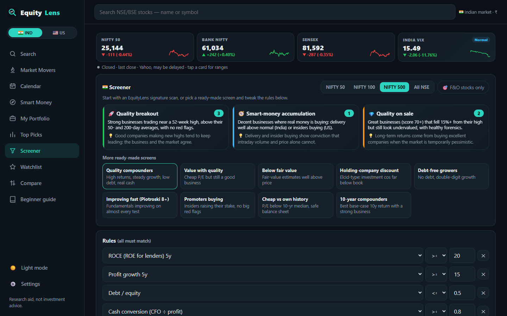<br/><b>🧮 Screener with the 3 signature scans</b></td>
<td align="center"><br/><b>📘 Beginner guide</b></td>
</tr>
<tr>
<td align="center">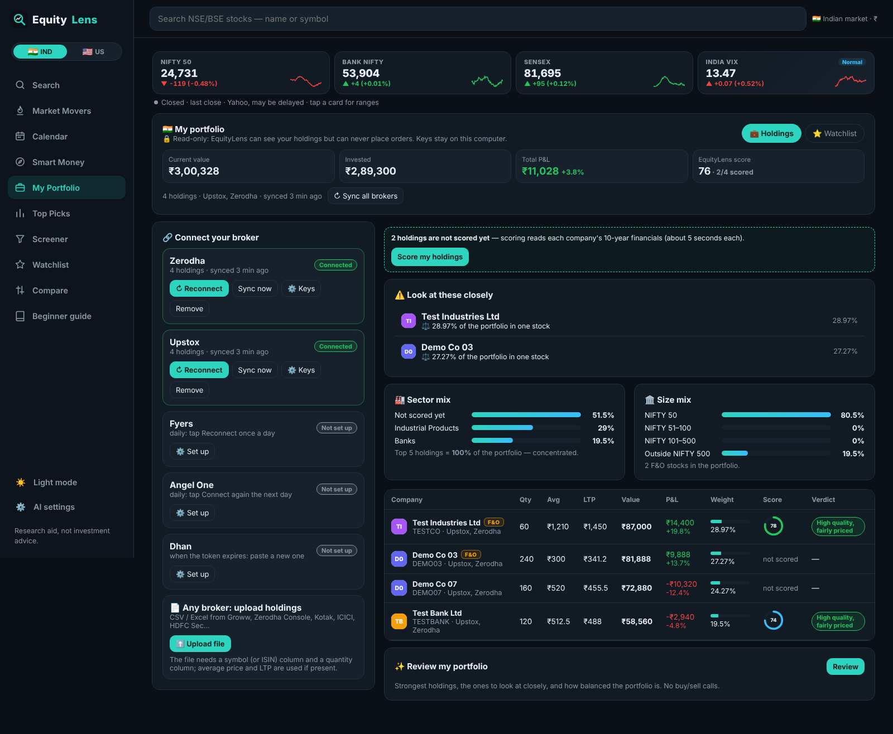<br/><b>💼 Portfolio X-ray from your broker</b></td>
<td align="center">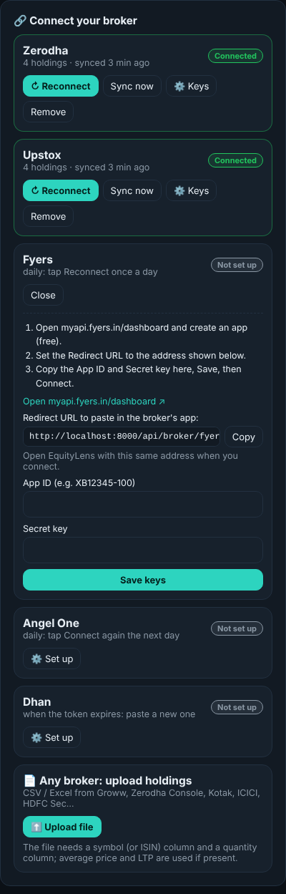<br/><b>🔗 Connect a broker or upload a holdings file</b></td>
</tr>
<tr>
<td align="center"><br/><b>🎯 F&O stocks only</b></td>
<td align="center">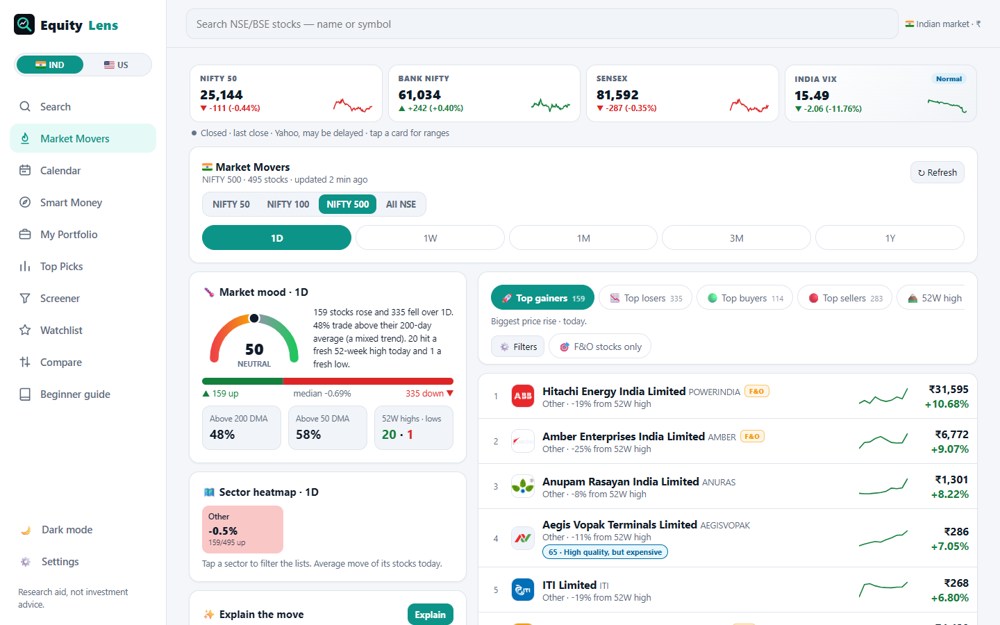<br/><b>☀️ Light theme</b></td>
</tr>
</table>

### 📱 Phone

<table>
<tr>
<td align="center" width="33%"><br/><b>Verdict and scores</b></td>
<td align="center" width="33%">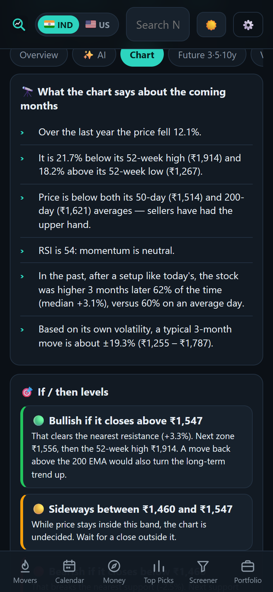<br/><b>What the chart says next</b></td>
<td align="center" width="33%"><br/><b>3 · 5 · 10-year outlook</b></td>
</tr>
<tr>
<td align="center"><br/><b>Valuation lab</b></td>
<td align="center"><br/><b>Forensics</b></td>
<td align="center"><br/><b>The 10-year story</b></td>
</tr>
<tr>
<td align="center"><br/><b>Market movers</b></td>
<td align="center">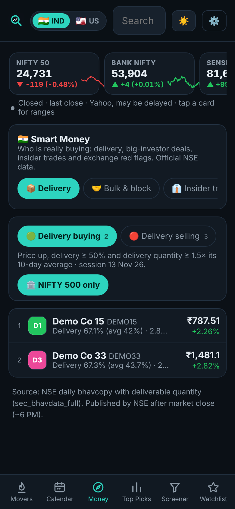<br/><b>Delivery buying</b></td>
<td align="center">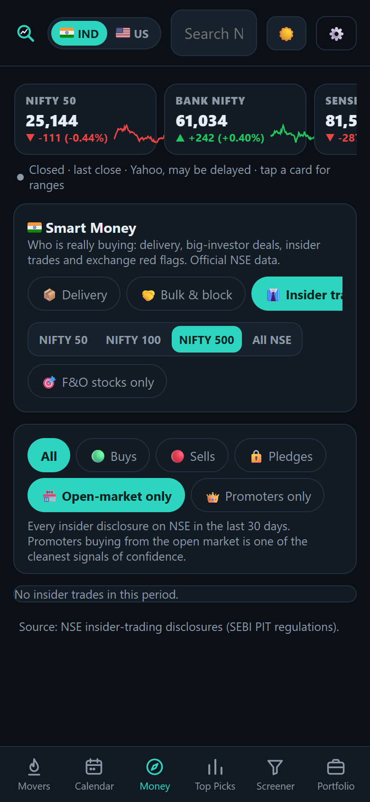<br/><b>Promoter and insider trades</b></td>
</tr>
<tr>
<td align="center"><br/><b>Earnings calendar</b></td>
<td align="center">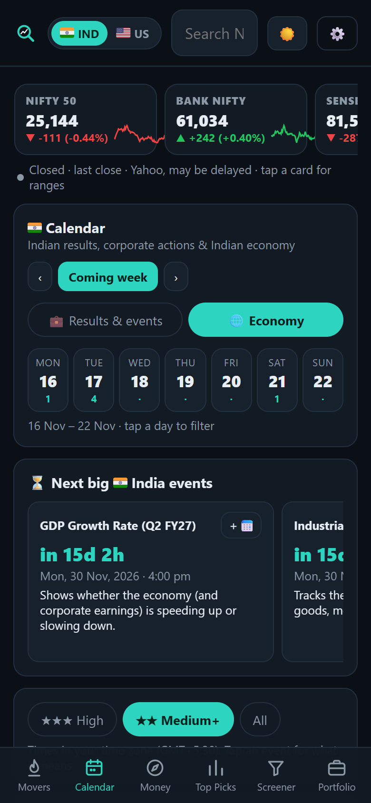<br/><b>Economic events explained</b></td>
<td align="center"><br/><b>AI analyst</b></td>
</tr>
<tr>
<td align="center"><br/><b>🇺🇸 US stock from SEC filings</b></td>
<td align="center"><br/><b>Signature scans</b></td>
<td align="center">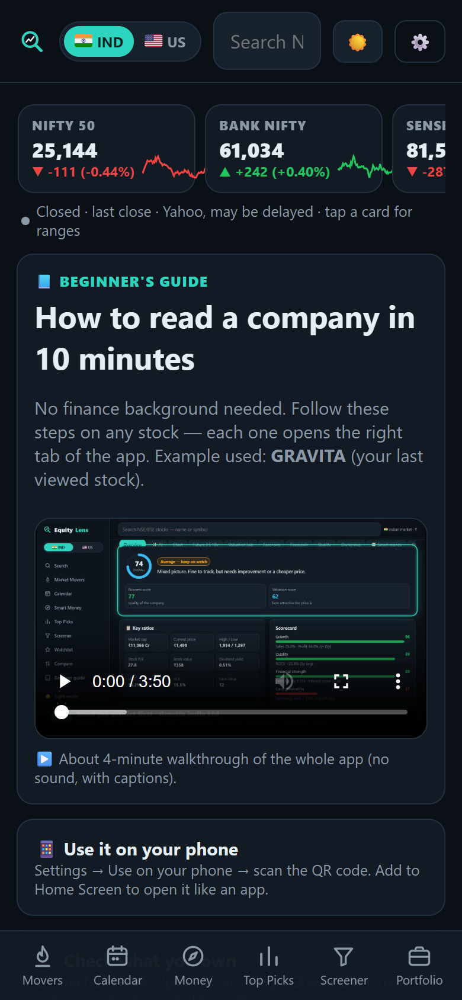<br/><b>Beginner guide</b></td>
</tr>
</table>

<sub>Screenshots use the built-in sample companies (demo mode) so they look the same on every machine. Real stocks show live data and real company logos.</sub>

---

## 🧰 Features

### 🔎 Stock report

Search any company by name or symbol. Each stock page has these tabs:

| | Tab | What you get |
|:-:|---|---|
| 🟢 | **Overview** | Verdict and overall score · 🚦 **entry decision** with ✨ AI research · key ratios · latest quarter (YoY / QoQ) · strengths ✅ and red flags 🚩 · fair value and forensic quick checks · company key points · next results date |
| ✨ | **AI** | Research note · ask-anything chat · management guidance check · bull vs bear debate with a judge · annual report and concall reader |
| 📈 | **Chart** | Daily/weekly candles (3M–10Y) · EMA 20/50/200 · Bollinger · Supertrend · support/resistance · volume · RSI · MACD · ADX · signal checklist |
| 🔭 | **Chart outlook** | The chart's story in plain English · if/then price levels · likely price range drawn on the chart · what happened after the same setup in the past |
| 🔮 | **Future 3·5·10y** | Bear / base / bull price and yearly return · reverse DCF (*what growth does today's price already assume?*) · every assumption shown |
| 💰 | **Valuation Lab** | Fair-value range (DCF, Graham, own median P/E, peer P/E, justified P/B) · DCF sliders · sensitivity grid · P/E bands · peer ranking |
| 🕵️ | **Forensics** | Piotroski F-score (bank-adapted) · Altman Z · Beneish M · DuPont ROE breakdown · accounting checks |
| 📊 | **Financials** | 10-year story timeline · 10–12 years of P&L, balance sheet, cash flow, ratios and quarters with charts |
| 🏭 | **Quality** | ROCE trend · profit vs operating cash · free cash flow · working-capital days |
| 👥 | **Ownership** | Promoter / FII / DII / public holding, quarter by quarter |
| 🧭 | **Smart money** | 10-day delivery % · insider and promoter trades · bulk and block deals |
| 💹 | **Price** | 10-year price with 200-day average and price CAGR |
| 📄 | **Reports** | Annual reports, concall transcripts, presentations, announcements, credit ratings (10-K / 10-Q / 8-K for US) |

A **🚨 surveillance banner** appears at the top when the exchange is watching the stock, and a **📅 results badge** shows when the next results are due.

### 🚦 Entry decision — is now a good time to buy?

On the Overview tab of every Indian stock, a card answers one question for a **1–3 year holding**: *enter now, or avoid for now?* It is worked out live each time you open the stock, from that day's prices, and it is not a promise. The card always shows how its rule has really done.

**The rules** (fixed in advance, the same live and in the backtest; no numbers were tuned on results):

| Verdict | Rule | When | What changes it |
|:-:|---|---|---|
| 🔴 **Avoid** | Business check | Loss-making, a serious forensic red flag, exchange surveillance, or business score under 55 | The business data changing (not backtested: past business scores don't exist) |
| 🔴 **Avoid** | Falling | Price below its 200-day average **and** that average is falling | No longer below a falling 200-day average: the card turns to *Enter* by itself. There is no "buy at ₹X" level |
| 🟢 **Enter** | Strong trend | Not falling, and stretched more than 3 ATRs above its 50-day average (or RSI above 75) | — expect swings |
| 🟢 **Enter** | Not falling | Everything else | Falling below a falling 200-day average |

Shown alongside, but **never changing the verdict**: the P/E vs the stock's own history (Cheap · Fair · Full · Expensive, with an ⚠️ caution when *Expensive*), the fair-value range, and a ⚠️ warning when results are due within 7 days.

**The backtest** — `backend/tools/entry_backtest.py` replays the rules at every month-end since 2016 on **all NSE stocks**, using only what was known on that day, and measures what happened over the next 12, 24 and 36 months. Results are compared **vs peers** (the average of every tested stock in the same month), which is fair between rules even though stocks that were delisted are missing. Calls on illiquid stocks (median traded value under ₹1 crore a day) are left out. A rule passes only if its claim holds in **both halves** (2016–20 and 2021 on) **and** in more than half of the months; this test was fixed before the run.

<details>
<summary><b>📊 What the all-NSE run showed</b> (17 Nov 2026: 1,541 stocks, 66,860 monthly calls)</summary>

<br/>

| Rule | 12 months vs peers | 2016–20 / 2021 on | Months it held | Test |
|---|---|---|---|---|
| Enter — strong trend | **+5.7%** | +9.2% / +5.2% | 70% | ✅ passed (also in and outside the NIFTY 500) |
| Enter — not falling | +0.7% | −1.2% / +0.9% | 62% | ❌ about the same as peers |
| Avoid — falling | **−4.0%** | −1.1% / −4.8% | trailed in 80% | ✅ passed (also in and outside the NIFTY 500) |

- Waiting for a falling stock to close back above its 200-day average and buying then returned **17.5% vs 25.2%** buying at once (same end date). That is why falling stocks are *Avoid*, not *wait for ₹X*.
- *Expensive* vs its own P/E history trailed peers by **7.8%** over 2 years and **17.8%** over 3 years, and trailed both *Cheap* and *Fair* in both halves; hence the caution. *Full* was not reliably worse.
- Earlier versions of the rules were dropped because the backtest showed them to be harmful: "wait, it's stretched" (stretched stocks did best), price buy zones (reached only ~24% of the time) and a 3-part buying plan (about 8 points a year worse than buying at once).
- Absolute returns are flattered by survivorship; only the "vs peers" numbers are shown on the card. The card always shows the **latest** run, not these numbers.
</details>

Run it once after installing, and again about once a month (each new month adds data):

```bat
cd backend
REM all NSE stocks (first run 2-3 hours, later runs much faster)
venv\Scripts\python tools\entry_backtest.py
REM or NIFTY 500 only
venv\Scripts\python tools\entry_backtest.py --universe N500
```

Test the Price map's support and resistance levels (about 10–30 minutes for all NSE: the test itself is quick, most of the time is downloading fresh prices):
```cmd
cd backend
venv\Scripts\python tools\levels_backtest.py
REM quick trial first
venv\Scripts\python tools\levels_backtest.py --limit 40
```

### 🌅 Pre-market — how is NIFTY likely to open?

Open **Pre-market** (side menu, or the card on the home page). From 08:20 to 09:15 IST it rebuilds every 10 minutes by itself:

- **Overnight markets**: S&P 500, NASDAQ, Dow and S&P futures now · Nikkei, Hang Seng, Kospi · Brent crude, gold, silver, Bitcoin · USD/INR, dollar index, US 10-year · US VIX and India VIX · yesterday's FII and DII cash flows (NSE). Every tile says **positive, negative or neutral for NIFTY** and why, from fixed rules.
- **NIFTY opening call**: one transparent score, fixed before any testing: S&P 500 ×3, US VIX ×−1, Brent crude ×−1, USD/INR ×−1, each from that market's last session that closed before 09:15 IST and scaled by its own normal daily move. Score ≥ +20 → gap-up likely, ≤ −20 → gap-down likely, otherwise flat or mixed.
- **Track record**: the same rules are backtested on every NIFTY day since 2016 (re-run weekly by itself). The page shows how often the open's direction was right compared with simply always guessing, for 2016–20 and 2021 on separately. It says plainly when there is **no edge for the day's direction** (open → close). Each morning's call is saved at 09:14 and checked against the real open; nothing is edited afterwards.
- **08:45 check**: the overnight call plus what happened after the US close: S&P 500 futures from the close to 08:45 IST (×3) and Nikkei + Kospi at 08:45 (×2). Yahoo keeps hourly prices for about two years, so it is tested on that window, and it becomes the main call **only if** it beats both the overnight call and always-guessing by 5+ points in both halves (fixed before testing). Until then it is shown as "not proven", with its numbers.
- **Day map** (levels and odds, not a forecast of the day's direction): the expected range from India VIX (last close ÷ √252 around the previous close) with how often NIFTY really stayed inside it since 2016; previous high / low / close, pivot, CPR (with its width), R1/R2/S1/S2; and a table of what NIFTY did after each size of opening gap since 2016 (gap filled the same day, closed above the open, average open → close). Today's gap is marked at 09:15.
- **Evening preview** (about 19:00–02:30 IST, while the US trades): the overnight formula on live prices for the next session, marked preliminary and not tested.
- **AI pre-market brief** (with an AI key): written only from the figures on the page, every number checked.
- **GIFT Nifty** has no free official feed or price history, so EquityLens can't read or test it; the page says so. Check it in your broker app.
- Coming next: verified global news (a story counts only when 2+ independent sources report it), stocks in focus from overnight filings, results, deals and US-listed shares, and a US pre-market page.

### 📍 Price map — where are the floors and ceilings, and how far could it fall?

Open any stock (Indian or US) → **📍 Price map** tab. Everything is measured on real daily prices of the stock, its sector index and its peers, with rules fixed before looking at any result (not tuned). Every claim shows how many cases it rests on; with fewer than 10 cases it lists the cases one by one and gives no percentages.

- **Where it stands**: fall from the highest close of the last 52 weeks, sessions since that high, and the stage (pullback < 10% · correction 10–20% · bear > 20%).
- **Support and resistance ladder**: swing highs and lows from the last 2 years (pivots within 1.5% are one level), the 50- and 200-day averages, the 52-week high and low, and heavy-trading zones (volume by price). Each level shows **how often it held**: a test = price came within 1%; held = it moved 3% away before closing 1% through, within 20 sessions.
- **Do these levels really work? (tested, not assumed)**: `tools\levels_backtest.py` checks on NSE stocks whether a level's past record predicts its NEXT test. At every month end since 2018 it builds the nearest support and resistance from prices up to that day only, groups them by their record so far (untested · 1–2 tests · 3+ tests held under 50% / 50–74% / 75%+), and records how the next test ended. Fixed before any run: it **passes** only if levels that held 75%+ held again 10+ points more often than levels that held under 50%, and 5+ points more often than all levels, in both halves (before 2021 / from 2021), with 100+ tests in each bucket and half. Every level on the tab then shows how levels with the same record did. Until the backtest is run, the tab says "not tested yet" and shows no such figure. US stocks: not tested.
- **How much further could it fall?** Every earlier time the stock first fell this far from its 52-week high, what happened next, up to its next 52-week high: half the time it fell less than X% more, 3 times in 4 less than Y%, the worst case, sessions to the low and how often it was back to that price within 3 months. The same cases for its sector peers (more cases), and its normal 1-month move. The fall still running is never counted.
- **Market, sector or just this stock?** NIFTY 50 (or the S&P 500 for US stocks), then the closest NSE sector index (e.g. NIFTY IT for TCS) or sector fund (US, e.g. SMH for NVIDIA, matched on the SEC industry): each one's fall from its high and trend, how many peers are above their 50-day average, the stock vs the sector over 3 months, and how much the stock moves with each. One fixed-rule answer: broad fall, sector fall, market fall or mostly this stock. A peer table shows how each sector stock is moving. If an index can't be loaded, the page says so.
- **Value floor from its own P/E history**: the price at which today's P/E would be Cheap, Fair, Full or Expensive against the stock's own P/E history (30th / 60th / 85th percentiles, at today's earnings), with how each P/E state did in the entry backtest (12, 24 and 36 months vs same-month peers, and how many stock-months). The backtest grades P/E state only, so the page says so when the entry card's combined state differs.
- **Signs of a turn**: five fixed signals (close back above the 20-day average, a higher low after a new low, RSI back above 30, selling volume drying up, the sector back above its 20-day average). Each shows whether it is on now and its **record on this stock**: how often the price was higher a month later after it switched on during past 10%+ falls, against any day in such a fall. It says plainly when a signal did **worse** or no better. No date for a turn is predicted.
- **Business positives and negatives** from the EquityLens analysis (strengths, red flags, value vs its own history, weak scores).
- **AI research** (with an AI key): is the fall the stock or the sector, which levels matter and why, what history says about further falls, which signals to watch, and what the business numbers say. Every figure is checked against the data ("Numbers checked: x of y"). There is no news in EquityLens data, so the AI is told not to invent news-driven reasons.

### 📊 Market dashboard

**Index card** — always at the top of the page, refreshed every minute:

| 🇮🇳 India | 🇺🇸 United States |
|---|---|
| NIFTY 50 · BANK NIFTY · SENSEX · INDIA VIX | S&P 500 · NASDAQ · DOW JONES · RUSSELL 2000 · VIX |

Each card shows the level, change, an intraday sparkline and (on tap) the day and 52-week range. The VIX card adds a plain-English fear level: *Calm · Normal · Nervous · Fear*.

**Market Movers** — the whole NIFTY 500 or S&P 500, for any timeframe from **1D to 1Y**:

| List | What it shows |
|---|---|
| 🚀 Top gainers · 📉 Top losers | Biggest rise / fall in the timeframe |
| 🟢 Top buyers · 🔴 Top sellers | Strongest buying / selling pressure, measured from up-day vs down-day volume. Tagged *only buyers / only sellers* when the stock closed at its high / low |
| 🏔️ 52W high · 🕳️ 52W low | New or near 52-week highs / lows; ✅ marks breakouts confirmed by volume |
| 🔊 Volume shockers · 💰 Most active | Unusual volume · highest traded value |
| 💎 Quality on sale | Strong businesses (score ≥ 70) trading 15%+ below their 52-week high |
| ⚠️ Hype watch | Fast risers with a weak business score or red flags |

Also on the page: a **market mood gauge** (extreme fear ↔ extreme greed) with a short explanation, a **sector heatmap**, filters (price, traded value, market cap, score, sector, 200-day trend, watchlist) and ✨ **Explain the move** with AI. Rows are tagged 📦 for heavy delivery and 🚨 for surveillance.

### 🧭 Smart money — who is really buying

| | Signal | What it tells you |
|:-:|---|---|
| 📦 | **Delivery buying / selling** 🇮🇳 | Price moved with delivery ≥ 50% and 1.5× the usual delivery quantity — real investors taking shares into demat, not intraday trading |
| 🤝 | **Bulk & block deals** 🇮🇳 | Which big investor bought or sold, how much and at what price; kept day by day for each stock |
| 👔 | **Insider & promoter trades** 🇮🇳 🇺🇸 | Promoters, directors and officers buying, selling or pledging. Open-market trades are highlighted; awards and option exercises are faded |
| ✅ | **Cluster buying** | Two or more insiders buying within 30 days — one of the stronger insider signals |
| 🚨 | **Surveillance flags** 🇮🇳 | GSM / ASM / ESM stages, insolvency, loan default, high pledge, loss-making 8+ quarters, BZ series, exit from F&O |

### 📅 Calendar

A week view with a day strip, for each market:

| | 🇮🇳 India | 🇺🇸 United States |
|---|---|---|
| 💼 **Results & events** | Results, dividends, bonus, splits, buybacks, fund raising, mergers (NSE board meetings) | Every company reporting: before open / after close, EPS estimate vs last year, then actual EPS and beat / miss |
| 🧾 **Week scorecard** | How many reported, how many rose after results, average reaction | How many reported, % that beat estimates, average reaction |
| 🌐 **Economy** | RBI policy, CPI, WPI, IIP, GDP, PMIs | Fed decisions, CPI, jobs, GDP, retail sales, ISM, jobless claims |
| 📌 **Official dates** | RBI MPC 10:00 AM · MoSPI CPI / IIP / GDP 4:00 PM · WPI 12:00 noon | Fed FOMC 2:00 PM ET |

- ⏳ **Countdown** to the next big events (RBI / Fed decision, CPI, GDP)
- 💡 Tap any event to see **what it is** and **why markets care**
- 🕓 Times shown in **your time zone** (a Fed decision at 2 PM ET is marked *next day* in India)
- ⭐ Your watchlist is pinned first; scanned stocks show their EquityLens score
- ＋📅 **Add to your phone, Google or Outlook calendar** with a reminder
- ✨ **Brief me on this week** — the AI explains which numbers and results matter

### 🧮 Screener and ⭐ signature scans

Three EquityLens signature scans sit at the top. Each one joins the **business**, the **price trend** and the **money flow**, and tells you what to check next:

| Scan | Finds | Why it works |
|---|---|---|
| 🚀 **Quality breakout** | Business score 65+, near a 52-week high, above its 50- and 200-day averages, no red flags | Good companies making new highs tend to keep leading |
| 🧭 **Smart-money accumulation** | Business score 60+ with delivery well above normal (🇮🇳) or insiders buying (🇺🇸) | Delivery and insider buying show conviction that price alone cannot |
| 💎 **Quality on sale** | Business score 70+, 15%+ below its high, still undervalued, Piotroski 6+ | Great businesses bought when the market is temporarily pessimistic |

Below them: 9 ready-made screens and your own rules on **55+ fields** — fundamentals, forensics, valuation, plus live fields (1W–1Y returns, 50/200-day trend, distance from high, relative volume, delivery %, insider buying, surveillance, F&O). Saved screens stay on your device.

### 🏛️ Stock lists: NIFTY 50 · NIFTY 100 · NIFTY 500 · All NSE

One selector (India) decides which stocks every list shows: Market Movers (with its mood gauge and sector heatmap), Calendar, Smart Money, Screener and Top Picks. It is remembered across pages.

| List | Stocks | Top Picks scan time |
|---|---|---|
| NIFTY 50 | 50 largest companies | ~3 min |
| NIFTY 100 | 100 largest | ~6 min |
| NIFTY 500 *(default)* | ~95% of the market by value | 30–60 min |
| All NSE | every listed company (~2,000+, EQ and BE series) | 2–3 hours |

Market Movers loads NIFTY 500 prices by default; pick **All NSE** and tap *Load all NSE stocks* once to cover every company (about 10–15 minutes in the background, then it refreshes on its own). Lists come from NSE Indices' constituent files and NSE's list of all listed equities, refreshed weekly.

### 🎯 F&O stocks

One **🎯 F&O stocks only** switch (India) filters Market Movers, Calendar, Smart Money, Screener and Top Picks together, and remembers your choice. Every F&O stock carries an **F&O** badge with its lot size, from NSE's official market-lots file.

### 📘 Beginner guide

For someone with zero stock-market knowledge: **11 steps** to read any company (each opens the right tab, with ✅ good signs and 🚩 warning signs), a **10-question checklist** that scores the stock as you tick, a **5-minute daily routine**, a **glossary** of 24 terms and the **walkthrough video**. Open it from the Home page or the sidebar.

### 💼 My Portfolio — connect your broker (read-only)

Bring in what you actually own, then let EquityLens check it the same way it checks any stock: a **score for every holding**, a value-weighted **portfolio score**, ⚠️ **look at these closely** (surveillance, red flags, pledged shares, one stock above 25%), **sector and NIFTY 50 / 100 / 500 mix**, **results coming up** and ✨ **Review my portfolio** with AI. The ⭐ Watchlist is a tab on the same page.

> [!IMPORTANT]
> **Read-only by design.** EquityLens only calls each broker's *holdings* API. It has no code that can place, change or cancel an order. Your API keys are stored only in `backend/data/brokers.json` on your own computer (git-ignored) and are shown masked in the app.

| Broker | Market | How you connect | API cost | Login lasts |
|---|:-:|---|---|---|
| **Zerodha** (Kite Connect) | 🇮🇳 | Create a *Personal* app at developers.kite.trade → paste API key + secret → **Connect** | Free (Personal plan) | Until 6 AM next day |
| **Upstox** | 🇮🇳 | Create an app at account.upstox.com/developer/apps → key + secret → **Connect** | Free | Until 3:30 AM next day |
| **Fyers** | 🇮🇳 | Create an app at myapi.fyers.in → App ID + secret → **Connect** | Free | 1 day |
| **Angel One** (SmartAPI) | 🇮🇳 | Create an app at smartapi.angelone.in → API key, client ID, PIN and TOTP secret → **Connect** (no browser step) | Free | 1 day |
| **Dhan** | 🇮🇳 | web.dhan.co → My Profile → *Access DhanHQ APIs* → generate a token → paste it | Free | Up to 30 days |
| **Alpaca** | 🇺🇸 | alpaca.markets → API keys (live or paper) → paste key ID + secret | Free | Until you revoke it |
| **Tradier** | 🇺🇸 | dash.tradier.com → API access → paste the access token | Free with an account | Until you revoke it |
| **Charles Schwab** | 🇺🇸 | developer.schwab.com → create an app (callback `https://127.0.0.1`) → **Connect** → paste the page address you land on | Free (app approval takes a few days) | 7 days, then reconnect (Schwab rule) |
| **📄 Any other broker** | 🇮🇳 🇺🇸 | Download your holdings as **CSV or Excel** and **Upload file** | — | — |

**Groww, Kotak, ICICI Direct, HDFC Securities, Motilal, 5paisa, Robinhood, Fidelity, Interactive Brokers…** have no free personal holdings API, so use the file upload. It finds the symbol (or ISIN), quantity, average price and LTP columns automatically, in any order, and maps ISINs to NSE symbols.

**Redirect URL.** For Zerodha, Upstox and Fyers the app shows the exact address to paste in the broker's app settings (for example `http://localhost:8600/api/broker/zerodha/callback`). Open EquityLens from the same address when you press **Connect**.

**Why it says "Reconnect" every morning.** SEBI rules make Indian broker logins expire daily, so after the first set-up you tap **Reconnect** once a day (two clicks). Holdings already imported stay visible until then.

**Funds and ETFs** (NIFTYBEES, GOLDBEES, SGBs, SPY…) have no company financials, so they count toward value and P&L but not toward the score.

### 🏆 Top Picks · ⭐ Watchlist · ⚖️ Compare

- **Top Picks** scans the whole NIFTY 500 or S&P 500 and ranks every company by the same rules; ✨ *explain this list* with AI
- **Watchlist** and **Compare** up to 4 stocks side by side

### ✨ AI analyst

| Agent | What it does |
|---|---|
| 🚦 Entry research | Opens by itself on the entry card: tests the engine's call against everything else in the data and shows sources and a number check (below) |
| 🧠 Research note | Full write-up: quality, growth, balance sheet, forensics, valuation, 3/5/10-year view, risks, what to watch |
| 💬 Ask about this stock | Chat grounded in that stock's own data — *"Is the debt a worry?"*, *"Why did margins fall?"* |
| 🎯 Guidance check | Grades each management target against the company's track record: achievable · stretch · unlikely |
| ⚔️ Bull vs bear | Two agents argue each side; a judge checks both against the data |
| 📄 Report reader | Reads annual reports and concall transcripts: guidance, capex, risks, tone |
| 📈 Chart explainer · 🔥 Explain the move · 📅 Weekly brief · 🏆 Explain my list | Plain-English explanations of charts, market moves, the calendar and ranked lists |

| Provider | Cost | Notes |
|---|---|---|
| **Claude** | Pay per use | Best for long reports |
| **ChatGPT** | Pay per use | Any chat model on your OpenAI account |
| **Gemini** | Free tier + paid | *Load my models* lists what your key can use |
| **Ollama** | Free | Runs locally on your laptop |
| **Demo** | Free | Offline sample answers |

> [!IMPORTANT]
> The AI sees only EquityLens's data for that stock and is instructed never to invent numbers. API keys are stored on your laptop only (`backend/data/ai_settings.json` or `backend/.env`, both git-ignored).

#### 🔌 Connect an AI (2 minutes)

| # | Step |
|:-:|---|
| 1 | Get a key: **Claude** at console.anthropic.com → API keys · **ChatGPT** at platform.openai.com → API keys · **Gemini** (free tier) at aistudio.google.com → Get API key · or install **Ollama** from ollama.com and run `ollama pull llama3.1:8b` (free, no key) |
| 2 | In EquityLens open **⚙️ Settings → AI**, pick the provider and paste the key (Gemini: tap **Load my models** and pick one) |
| 3 | Tap **Save & test connection**. A green reply means it works |
| 4 | Open any stock. The ✨ AI research appears on the entry card within 20–60 seconds the first time |

Prefer a file? Put the same values in `backend/.env` (`EQL_AI_PROVIDER`, `ANTHROPIC_API_KEY` / `OPENAI_API_KEY` / `GEMINI_API_KEY`, and the model names; see `backend/.env.example`).

#### 🔍 What the AI does when you open a stock

1. **Builds an evidence pack** from EquityLens's own data: the entry decision and how its rule did in the backtest (including for stocks in the same group, NIFTY 500 or not), the last 8 quarters, 10+ years of P&L, balance sheet and cash flow, forensic scores and red flags, P/E vs its own history, fair value and scenarios, peers, promoter / FII / DII changes, trend levels and the results date.
2. **Researches in a fixed order** — the rule's track record → the business now → price vs value → ownership → timing — and answers in a fixed format:
   - a one-line **headline** and whether it **agrees / partly agrees / disagrees** with the engine (the verdict itself never changes)
   - **Why it could work** and **What could go wrong**, each point with its exact figures and a source tag (Quarters, Valuation, Track record…)
   - **What would change the call** as measurable conditions, and **Watch next** with today's value of each item
   - **Confidence** (low / medium / high) and what is missing from the data
3. **Checks every number.** Each figure the AI quotes is matched against the data it was given. The card shows *"Numbers checked: 14 of 15 found in EquityLens data"*, and any figure that isn't in the data is flagged in orange next to the point it came from.
4. **Ask about this entry** — a chat box under the research (*"What would make this an Enter?"*, *"What do the results need to show?"*), answered from the same data.

The research is saved per stock for the day, so opening the stock again is instant and doesn't use another AI call; **↻ Redo** asks again. The entry decision is also part of every other AI feature (note, chat, debate), so the AI never contradicts the card.

### 🇮🇳 / 🇺🇸 Two markets, one app

Tap **🇮🇳 IND** or **🇺🇸 US** at the top. Search, movers, calendar, smart money, Top Picks and the screener all switch to that market.

| | 🇮🇳 India | 🇺🇸 United States |
|---|---|---|
| Stocks | NSE and BSE | NYSE and Nasdaq (every SEC filer) |
| Amounts | ₹ crore | US$ million |
| Index scans | NIFTY 500 | S&P 500 |
| Ownership | Promoter / FII / DII trend | Not reported the same way, so not scored |

---

## 🚀 Getting started

### Requirements

- Windows 10/11 (macOS / Linux work with the manual steps)
- [Python 3.11+](https://www.python.org/downloads/)
- Internet connection
- *Optional:* an AI key (Claude, OpenAI or Gemini) or [Ollama](https://ollama.com) · [Tailscale](https://tailscale.com) to open it on your phone · Node.js only if you want to change the frontend

### Install and run

```bat
git clone https://github.com/dhanunjaya-kd/equitylens
cd equitylens
```

Then pick how you like to start it:

| | How | What you get |
|---|---|---|
| 🖱️ **Like an app** *(recommended)* | Double-click **`EquityLens.vbs`** | No black window. Starts quietly and opens EquityLens in its own app window. The first run sets everything up (1–3 minutes). |
| 🖥️ **With a console** | Double-click **`start.bat`** | Same app, plus a console window showing the live log. Good for troubleshooting. |

> [!TIP]
> Double-click **`Create Desktop Shortcut.vbs`** once. It adds an **EquityLens** icon to the Desktop and the Start menu (plus **Stop EquityLens**), and can start EquityLens in the background whenever Windows starts, so your phone can always reach it.

| File | What it does |
|---|---|
| `EquityLens.vbs` | Starts the server with no window (`pythonw`), waits until it's ready, opens the app. Already running? Just opens it. After `git pull` it installs any new packages by itself. |
| `Stop EquityLens.vbs` | Stops the background server. |
| `Create Desktop Shortcut.vbs` | Desktop + Start-menu shortcuts with the EquityLens icon; optional start with Windows. |
| `start.bat` | Console version; `start.bat setup` only installs. |

With no window there is nowhere for messages to appear, so everything goes to **`backend/data/logs/equitylens.log`** (kept to 4 × 2 MB). Open **⚙️ Settings → 🧾 Logs** to read it in the app. Set `EQL_OPEN=browser` in `backend/.env` to open a normal browser tab instead of an app window.

<details>
<summary><b>Manual setup (macOS / Linux, or step by step)</b></summary>

```bash
cd backend
python3 -m venv venv
source venv/bin/activate            # Windows: venv\Scripts\activate
pip install -r requirements.txt
python selftest.py
python run.py
```
</details>

### First steps

| # | Step | Why |
|:-:|---|---|
| 1 | Copy `backend/.env.example` to `backend/.env` and set `EQL_SEC_USER_AGENT` to your name and email | The SEC requires it for US data (sent only to sec.gov) |
| 2 | Run `python selftest.py` in `backend/` | Checks every live source end to end and prints exactly what was read |
| 3 | New to stocks? Open **📘 Beginner guide** | 11 steps, a checklist and the walkthrough video |
| 4 | Search any stock | Full report in about 5 seconds, cached for 24 hours (↻ Refresh fetches new data) |
| 5 | ⚙️ Settings → choose an AI provider | Optional: Claude, ChatGPT, Gemini, or free local Ollama |
| 6 | Top Picks → pick **NIFTY 50 / 100 / 500 / All NSE** (or S&P 500) → **Start scan** | Builds the rankings used by Top Picks, the screener and the signature scans. Start with NIFTY 50 (~3 min); re-run weekly |
| 7 | Run the entry backtest once: `venv\Scripts\python tools\entry_backtest.py` in `backend/` | Fills the track record shown on every entry card (first run 2–3 hours; see 🚦 Entry decision) |
| 8 | Open **Movers**, **Calendar** and **Money** once | First load downloads the index's daily prices and NSE files (a few minutes); after that they refresh in the background |

### 📱 Phone and ☁️ cloud

| Where | How |
|---|---|
| **Laptop** | http://localhost:8600. Wider than ~1100 px gets the desktop layout with a sidebar. |
| **Phone, same Wi-Fi** | **⚙️ Settings → 📱 Use on your phone** → scan the QR code. |
| **Phone, anywhere** | Free **Tailscale** app on laptop and phone → scan the 🌐 Tailscale QR code. |
| **Laptop off (24×7)** | Host it on a cloud server: free Oracle Cloud VM, `docker compose up -d` or a systemd service, password-protected. |
| **Like an app** | iPhone: *Share → Add to Home Screen* · Android: *⋮ → Add to Home screen*. |

👉 **Step-by-step guide with every command: [docs/CLOUD_AND_PHONE.md](docs/CLOUD_AND_PHONE.md)**

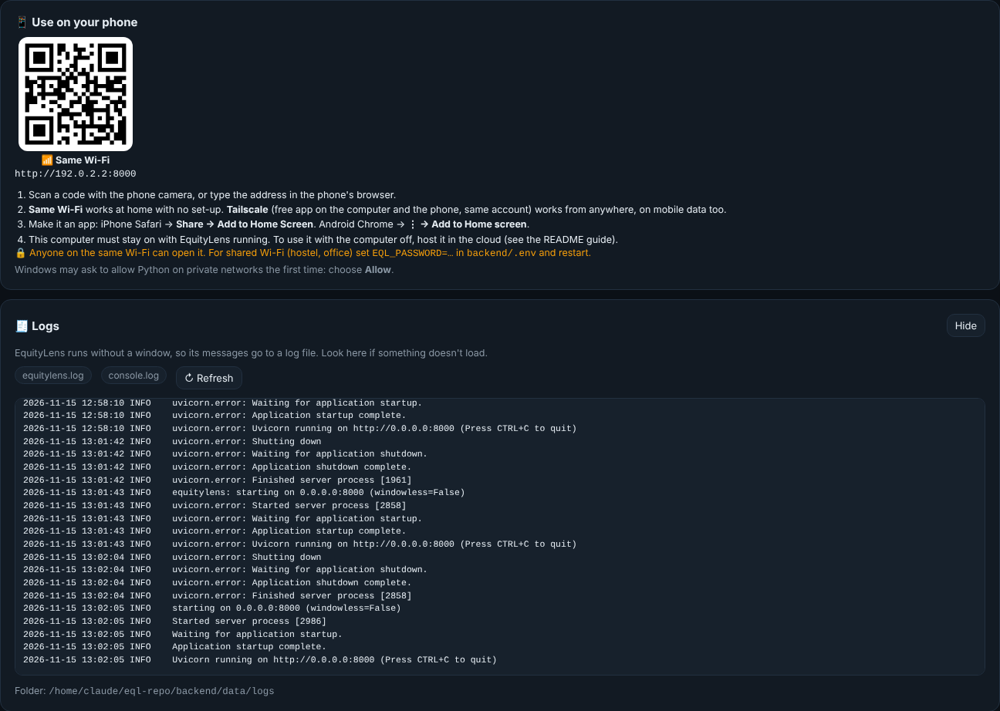

> [!IMPORTANT]
> Reachable from the internet or on shared Wi-Fi? Set **`EQL_PASSWORD`** in `backend/.env`. EquityLens then shows a sign-in page and every API call needs it. Settings holds your AI and broker keys.

<details>
<summary><b>⚙️ Configuration (<code>backend/.env</code>)</b></summary>

| Variable | Default | What it does |
|---|---|---|
| `EQL_SEC_USER_AGENT` | — | Your name and contact for SEC EDGAR (required for US stocks) |
| `EQL_AI_PROVIDER` | `claude` | `claude` · `openai` · `gemini` · `ollama` · `demo` |
| `EQL_REQUIRED_RETURN` | `0.12` | Target yearly return used in reverse DCF and the default DCF |
| `EQL_FAIR_EXIT_PE` | `20` | Exit P/E for reverse DCF |
| `EQL_CACHE_TTL_HOURS` | `24` | How long a fetched stock is reused |
| `EQL_SCAN_DELAY` | `3` | Seconds between companies in a scan (keeps requests polite) |
| `EQL_PORT` | `8600` | Web port |
| `EQL_PASSWORD` | — | Sign-in password. **Required** on a cloud server or shared Wi-Fi |
| `EQL_HOST` | `0.0.0.0` | `127.0.0.1` = only this computer (use behind Caddy on a server) |
| `EQL_OPEN` | `app` | `EquityLens.vbs` opens an app window (`app`) or a browser tab (`browser`) |
| `EQL_DEMO` | `0` | `1` = offline demo with sample companies **TESTCO**, **TESTBANK** and 🇺🇸 **TSTUS** |

AI keys and model names: see `backend/.env.example`, or set them in ⚙️ Settings.
</details>

---

## 🧭 How it works


A single Python process (FastAPI) fetches the data, analyses it, caches it in a local SQLite file and serves the prebuilt React app. Every source is fetched politely (paced, retried, cached), and one failing source never breaks the rest of the page.

### Verdicts

| | Verdict | Meaning |
|:-:|---|---|
| 🟢 | **High quality, fairly priced** | Strong business; the price still leaves room for returns |
| 🔵 | **High quality, but expensive** | Great business; the price already expects a lot |
| 🟡 | **Average — keep on watch** | Mixed picture worth tracking |
| 🟠 | **Good numbers, serious red flags** | Check the flags before trusting the scores |
| 🔴 | **Weak — avoid for now** | Fundamentals or red flags argue against holding |
| ⚫ | **Loss-making — speculative** | No current earnings; a turnaround bet |
| ⚪ | **Not enough data** | Under 3 years of usable numbers: not rated, not ranked |

<details>
<summary><b>📐 Scoring and scenario rules</b> (also visible inside the app)</summary>

<br/>

| Score (0–100) | Built from |
|---|---|
| 🌱 Growth | 5-year profit and sales CAGR, years of profit growth |
| 🏭 Quality | 5-year average ROCE (ROE for banks), margin stability |
| 🛡️ Strength | Debt/equity, interest coverage (equity/assets for banks) |
| 💵 Cash | Operating cash ÷ profit, free-cash years (skipped for banks) |
| 👥 Ownership | Promoter level and trend, FII + DII trend, pledging |
| 🏷️ Valuation | P/E, PEG, P/E vs its own 10-year median, P/B for banks |

**Business score** = growth 28% + quality 28% + strength 17% + cash 17% + ownership 10% · **Overall** = 80% business + 20% valuation.

**Future scenarios:** start from last-12-month EPS → grow at a blend of 3/5/10-year profit growth (capped at sales growth + 5 points and at 25%) → growth fades to 4 / 8 / 11% by year 10 (bear / base / bull) → P/E starts at its 10-year median and drifts toward 12–25. Returns include the dividend yield.

**Chart outlook:** the likely range uses the stock's own past-year volatility with no direction assumed. *Same setup before* finds every past day with the same trend and momentum state (price vs 200 EMA, 50 vs 200 EMA, RSI zone, MACD vs signal) and measures the price 1, 3 and 6 months later against an average day.

**Market mood:** average of advances vs declines, % of stocks above their 50- and 200-day averages, stocks near 52-week highs vs lows, and the median move.
</details>

---

## 🌐 Data sources

All free and public. No logins, no paid feeds.

| Data | 🇮🇳 India | 🇺🇸 United States |
|---|---|---|
| Financials (10+ years) | screener.in public company pages | SEC EDGAR XBRL filings (10-K / 10-Q) |
| Prices, charts, indices | Yahoo Finance public chart feed | Yahoo Finance public chart feed |
| Stock lists | NIFTY 50 / 100 / 500 constituents (niftyindices.com) · all listed equities (NSE EQUITY_L) | S&P 500 constituents |
| F&O stocks and lot sizes | NSE F&O market-lots file | — |
| Delivery % | NSE daily bhavcopy with deliverable quantity | — |
| Bulk & block deals | NSE bulk / block deal files | — |
| Insider trades | NSE insider-trading (SEBI PIT) disclosures | SEC Form 4 |
| Surveillance flags | NSE surveillance indicator file (REG_IND) | — |
| Results calendar | NSE event calendar (board meetings) | Nasdaq earnings calendar |
| Economic calendar | Nasdaq economic calendar + RBI, MoSPI and DPIIT official schedules | Nasdaq economic calendar + Federal Reserve FOMC schedule |
| Documents | Annual reports, concalls, announcements (company page) | 10-K, 10-Q, 8-K (SEC) |
| Logos | Financial Modeling Prep public logo images, or the company's website icon | same |

If a source changes its format, `python selftest.py` shows exactly which part broke.

---

## 🧪 Quality and testing

```bat
cd backend
python run_tests.py
```

143 offline tests run against saved copies of each source's real format, so they pass without internet. The entry engine has 11 more (`pip install pytest`, then `python -m pytest tests/test_entry.py`):

| Suite | Covers |
|---|---|
| `test_engine.py` | Parsing, scores, flags, forensics, valuation and indicator maths (EMA, RSI, MACD, ADX checked against reference formulas) |
| `test_stress.py` | 12 broken or partial-data cases (no cash flow, 2 years only, negative equity, all losses, no price…) never crash and are never over-rated |
| `test_us.py` | SEC filings: revenue tag changes merged, year-to-date figures ignored, Q4 derived, TTM, ratios |
| `test_movers.py` | Returns per timeframe, buying/selling pressure, turnover, relative volume, 52-week breakouts, mood, sector heatmap |
| `test_flows.py` | NSE delivery, deals, insider and surveillance formats; SEC Form 4; cluster and net-buying maths |
| `test_enrich.py` | NSE F&O market-lots file, live trend / delivery / insider / surveillance fields joined onto every list |
| `test_universe.py` | NIFTY 50 / 100 / 500 and All NSE lists (NSE file formats), index membership, movers filtered by list |
| `test_calendar.py` | Nasdaq and NSE calendar formats, official RBI / MoSPI / WPI / FOMC dates and IST / ET times, de-duplication, logos |
| `test_indices.py` | Index quotes, change maths, market open/closed, VIX bands |
| `test_brokers.py` | Every broker's holdings format, TOTP (RFC 6238 test vectors), CSV and Excel uploads with ISIN mapping, masked keys, merging the same stock across brokers |
| `test_access.py` | Password sign-in, protected keys, shutdown only from this computer, phone addresses, log viewer |
| `test_ai.py` | Exact request formats for Claude, OpenAI, Gemini and Ollama; error handling; masked keys; entry research parsing, retry, caching and flagging of invented numbers |
| `test_premarket.py` | The opening call uses only sessions closed before the NIFTY day, dates stay in each market's time zone, the backtest finds a real link and rejects noise, frozen calls are checked against the real open |
| `test_pricemap.py` | Hold-rate maths (held, broken, unresolved), the level backtest uses no future prices and counts each test once, its pass rule at the edges, market / sector / stock answer, value ranges tied to P/E state, the fall still running is excluded, fewer than 10 cases gives no percentages, turn signals use no future prices, sector mapping, the AI's numbers are checked |
| `test_entry.py` | Every entry rule gives the verdict it promises, uses only past prices, and the backtest runs end to end with the pass test |
| `test_api.py` | Every endpoint, including error paths |

---

## 🗂️ Project structure

```
equitylens/
├── EquityLens.vbs            start with no window, open as an app (Windows)
├── Stop EquityLens.vbs       stop the background server
├── Create Desktop Shortcut.vbs  Desktop / Start-menu icon, optional start with Windows
├── start.bat                 start with a console window
├── Dockerfile · docker-compose.yml   run on a server
├── deploy/                   systemd service and Caddy (HTTPS) examples
├── backend/
│   ├── app/
│   │   ├── main.py           API + serves the web app
│   │   ├── service.py        fetch → cache → analyse, index scans
│   │   ├── scraper.py        🇮🇳 company pages (paced, retried, cached)
│   │   ├── parser.py         HTML → clean tables, key points, peers, documents
│   │   ├── us.py             🇺🇸 SEC EDGAR → the same tables
│   │   ├── analysis.py       metrics, scores, flags, scenarios, verdict, 10-year story
│   │   ├── forensics.py      Piotroski · Altman · Beneish · DuPont
│   │   ├── valuation.py      DCF · Graham · P/E bands · EV · fair value
│   │   ├── technicals.py     indicators + chart outlook
│   │   ├── movers.py         market movers, pressure, mood, sector heatmap
│   │   ├── indices.py        index card quotes and VIX bands
│   │   ├── flows.py          delivery, deals, insider trades, surveillance, Form 4
│   │   ├── calendars.py      results and economic calendars, official schedules
│   │   ├── enrich.py         F&O list + live fields joined onto every list
│   │   ├── logos.py          company logos with initials fallback
│   │   ├── entry.py          entry decision rules (Enter / Avoid), live and in the backtest
│   │   ├── premarket.py      overnight board, NIFTY opening call, its backtest and frozen live calls
│   │   ├── nextday.py        08:45 check (and its test), day map, evening preview
│   │   ├── pricemap.py       price map: levels and hold rates, fall cases, sector check, turn signals
│   │   ├── ai.py             Claude / OpenAI / Gemini / Ollama agents, entry research + number check
│   │   ├── brokers.py        read-only holdings from 8 brokers + CSV / Excel import
│   │   ├── portfolio.py      portfolio X-ray: merge, score, warnings, mix
│   │   ├── access.py         password sign-in, phone addresses, log viewer
│   │   ├── money.py · store.py · universe.py · config.py
│   ├── static/               prebuilt web app (no Node.js needed to run)
│   ├── tests/                offline tests + sample data
│   ├── tools/                entry_backtest.py: track record of the entry rules · make_video.py · make_screenshots.py
│   └── run.py · selftest.py · run_tests.py · scan.py   (logs → data/logs/)
├── frontend/                 React + Vite source (npm install && npm run build)
└── docs/                     screenshots, walkthrough video, CLOUD_AND_PHONE.md guide
```

<details>
<summary><b>API reference</b></summary>

| Endpoint | Purpose |
|---|---|
| `GET /api/search?q=&market=` | Find a company |
| `GET /api/stock/{symbol}` · `GET /api/chart/{symbol}` | Full report · chart data and outlook |
| `GET /api/compare?symbols=` | Up to 4 reports side by side |
| `GET /api/rankings` · `POST /api/scan/start` | Rankings · start an index scan |
| `GET /api/movers?market=&tf=` | Market movers, mood and sectors |
| `GET /api/indices?market=` | Index card |
| `GET /api/flows/stock/{symbol}` | Delivery, deals, insiders and surveillance for one stock |
| `GET /api/flows/delivery` · `deals` · `insiders` · `surveillance` | Market-wide smart-money lists |
| `GET /api/calendar/earnings` · `economy` · `next/{symbol}` | Calendars and next results date |
| `POST /api/ai/{note,chat,guidance,debate,doc,chart}/{symbol}` | AI features for a stock (`chat` takes `focus: "entry"` for questions about the entry card) |
| `GET /api/premarket?market=IN&refresh=` · `POST /api/premarket/backtest` · `POST /api/ai/premarket` | Pre-market board, opening call, backtest, AI brief |
| `GET /api/pricemap/{symbol}?refresh=` · `POST /api/ai/pricemap/{symbol}` | Price map for one stock, AI research on it |
| `POST /api/ai/entry/{symbol}?refresh=` | AI research on the entry decision: structured, sourced, numbers checked |
| `POST /api/ai/{picks,movers,calendar}` | AI explanations of lists, moves and the week |
| `GET /api/fno` | F&O stocks and lot sizes |
| `GET /api/universe` | NIFTY 50 / 100 / 500 / All NSE sizes and index membership |
| `GET /api/logo/{symbol}` | Company logo |
| `GET /api/brokers` · `POST /api/brokers/{id}/config` · `connect` · `sync` · `DELETE /api/brokers/{id}` | Broker set-up and read-only holdings sync |
| `GET /api/auth` · `POST /api/login` · `logout` | Password sign-in (when `EQL_PASSWORD` is set) |
| `GET /api/network` · `GET /api/logs` · `POST /api/shutdown` | Phone addresses, log viewer, stop (this computer only) |
| `POST /api/portfolio/upload` | Import a CSV / Excel holdings file |
| `GET /api/portfolio?market=` · `POST /api/portfolio/score` · `POST /api/ai/portfolio` | Portfolio X-ray, score unscored holdings, AI review |

`symbol` is the NSE symbol (e.g. `RELIANCE`) or `US:` + ticker (e.g. `US:AAPL`).
</details>

---

## 🛣️ Roadmap

- [ ] 🔔 Telegram alerts and a morning digest: watchlist results, big economic events, 52-week breakouts, verdict changes
- [ ] 🧾 Results-day analyser: new quarter vs estimates and vs the 3/5/10-year assumptions
- [x] 💼 Portfolio X-ray: connect your broker or upload holdings, see combined score, concentration and red flags
- [x] ☁️ Cloud hosting guide, Docker and password protection so it works with the laptop off
- [x] 🖱️ Windowless Windows launcher with desktop shortcut and log file
- [x] 🚦 Entry decision with a backtested track record on all NSE stocks, and AI research on every entry
- [ ] 📈 Score track record: monthly snapshots to check whether high scores beat low scores

---

> [!NOTE]
> Prefer reaching EquityLens through Tailscale. If it must be public, put it behind HTTPS (Caddy) with `EQL_PASSWORD` set. See [docs/CLOUD_AND_PHONE.md](docs/CLOUD_AND_PHONE.md).

> [!WARNING]
> Everything is built from **past numbers and stated assumptions**. EquityLens is a research aid, **not investment advice**. Read the red flags and the company's own reports before investing.

<div align="center">
<br/>

Made with 💚 for long-term investing

</div>
