<div align="center">

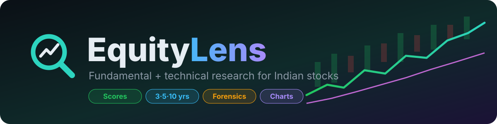

<br/>


### 🔎 Search any 🇮🇳 Indian or 🇺🇸 US stock → a complete, explained research report in seconds

**Not just numbers: a verdict, the reasons, the risks, what the chart says next, and what has to go right for 3, 5 and 10 years.**

</div>

---

## 🆚 What makes EquityLens different

Most stock sites show you the numbers. EquityLens **reads them for you**, explains them in plain English and tells you what to check next.

| | Typical stock sites | **EquityLens** |
|---|:-:|:-:|
| 10+ years of P&L, balance sheet, cash flow, quarters, shareholding | ✅ | ✅ |
| One clear **verdict** with the reasons and 6 scores (0–100) | ➖ | ✅ |
| **Red flags** written out (debt, cash conversion, promoter selling, pledging, dilution…) | ➖ | ✅ |
| **Forensic checks**: Piotroski F, Altman Z, Beneish M, DuPont | ➖ | ✅ |
| **3 / 5 / 10-year bear-base-bull** price & return, with every assumption visible | ➖ | ✅ |
| **Reverse DCF**: "what growth does today's price already expect?" | ➖ | ✅ |
| **Interactive DCF** with sliders + sensitivity grid + fair-value range from 5 methods | ➖ | ✅ |
| **Chart outlook**: if/then levels, likely price range, *what happened after the same setup before* | ➖ | ✅ |
| **10-year story** timeline (big jumps, margin shifts, debt, dilution called out) | ➖ | ✅ |
| **Peer ranking** bars (where it stands on ROCE, P/E, growth…) | ➖ | ✅ |
| **AI analyst**: research note, chat, bull-vs-bear debate, guidance check, report reader | ➖ | ✅ |
| Your own **screens on 45+ fields** incl. forensic & fair-value fields | ➖ | ✅ |
| **🇮🇳 India + 🇺🇸 US** in one app, one tap to switch, same analysis for both | ➖ | ✅ |
| Built for **both phone and desktop**: bottom tabs on phone, sidebar + multi-column pages on laptop | ➖ | ✅ |
| **Market Movers** across 1D · 1W · 1M · 3M · 1Y: gainers, losers, buyers, sellers, 52W high/low, volume, most active | ✅ | ✅ |
| Movers **joined with fundamentals**: 💎 *Quality on sale* and ⚠️ *Hype watch* (fast risers with weak business) | ➖ | ✅ |
| **Buying / selling pressure measured from volume** (up-day vs down-day volume), not just price change | ➖ | ✅ |
| **Market mood gauge** (fear ↔ greed) with a plain-English read + **sector heatmap** for every timeframe | ➖ | ✅ |
| ✨ **"Explain the move" with AI**: why today's leaders and laggards moved, in plain words | ➖ | ✅ |
| ☀️ / 🌙 **Light and dark theme**, remembers your choice | ✅ | ✅ |
| Runs on **your** laptop, your data and keys stay with you | ➖ | ✅ |

<sub>➖ = not offered, or only partly, by most free sites.</sub>

---

## 📸 Screenshots

### 🖥️ Web (laptop / desktop)

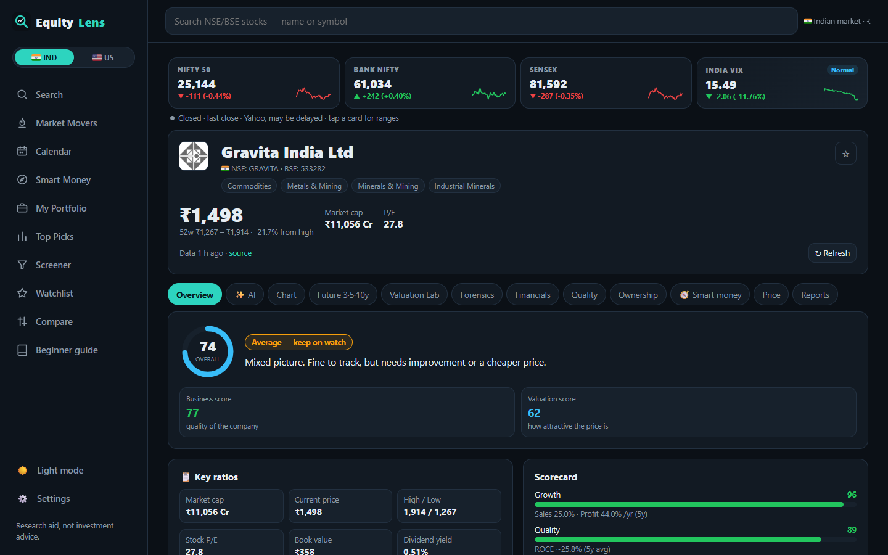

<table>
<tr>
<td align="center"><br/><b>📈 Chart with future range</b></td>
<td align="center"><br/><b>🔭 Chart outlook & signal checklist</b></td>
</tr>
<tr>
<td align="center"><br/><b>💰 Valuation Lab & peer ranking</b></td>
<td align="center"><br/><b>🕵️ Forensics</b></td>
</tr>
<tr>
<td align="center"><br/><b>✨ AI note, chat & bull-vs-bear debate</b></td>
<td align="center"><br/><b>🏆 Top Picks ranking table</b></td>
</tr>
<tr>
<td align="center">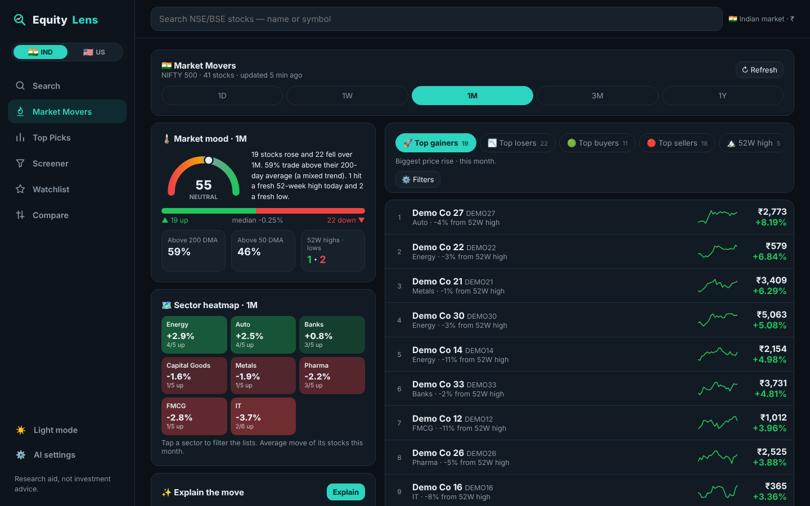<br/><b>🔥 Market Movers: mood, sector heatmap, lists</b></td>
<td align="center"><br/><b>☀️ Light theme: Top buyers this month</b></td>
</tr>
<tr>
<td align="center">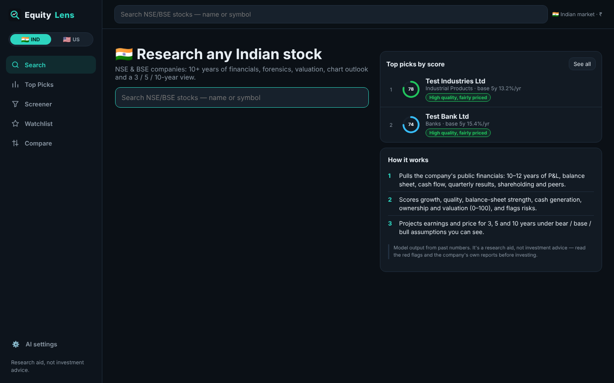<br/><b>🔎 Home with sidebar & 🇮🇳/🇺🇸 switch</b></td>
<td align="center">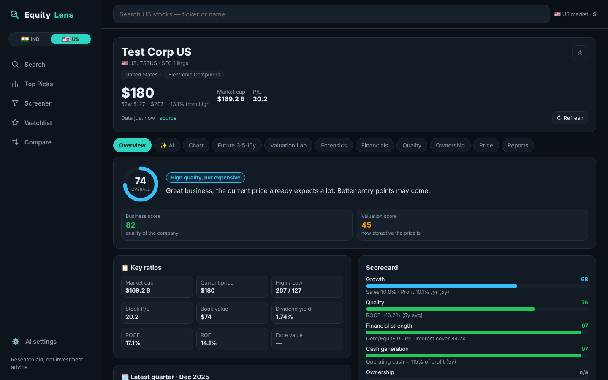<br/><b>🇺🇸 US stock in $ (SEC filings)</b></td>
</tr>
</table>

### 📱 Phone

<table>
<tr>
<td align="center"><br/><b>🟢 Verdict & scores</b></td>
<td align="center">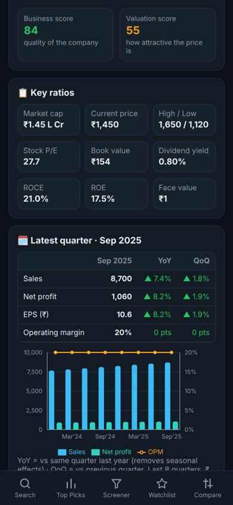<br/><b>📋 Key ratios & latest quarter</b></td>
<td align="center">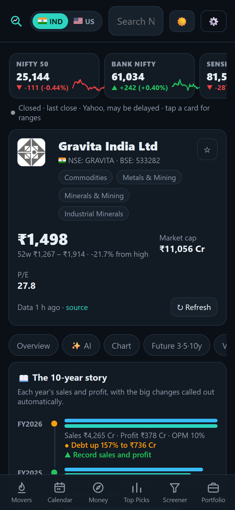<br/><b>📖 The 10-year story</b></td>
</tr>
<tr>
<td align="center"><br/><b>📈 Chart + future range</b></td>
<td align="center"><br/><b>🔭 What the chart says next</b></td>
<td align="center"><br/><b>🔮 3 · 5 · 10-year outlook</b></td>
</tr>
<tr>
<td align="center"><br/><b>💰 Valuation Lab (live DCF)</b></td>
<td align="center">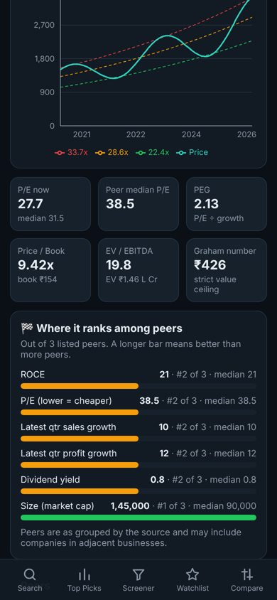<br/><b>🏁 Peer ranking</b></td>
<td align="center"><br/><b>🕵️ Forensics</b></td>
</tr>
<tr>
<td align="center">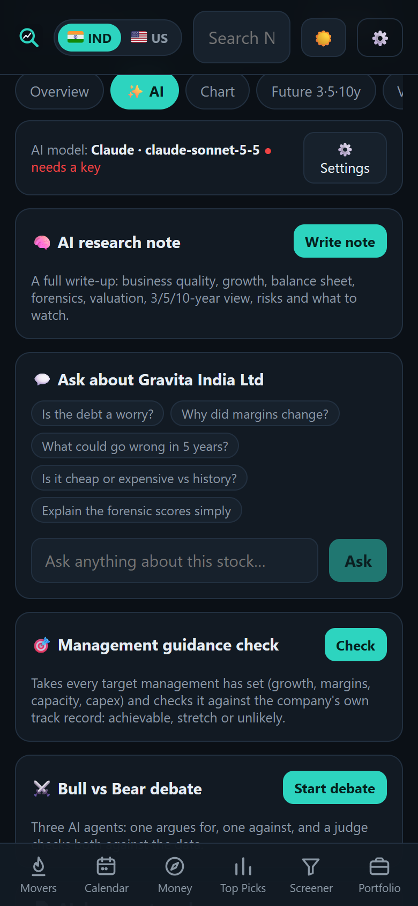<br/><b>✨ AI note, chat & debate</b></td>
<td align="center">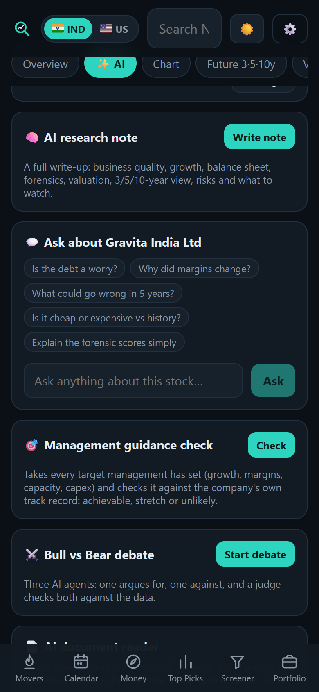<br/><b>🎯 Guidance check</b></td>
<td align="center">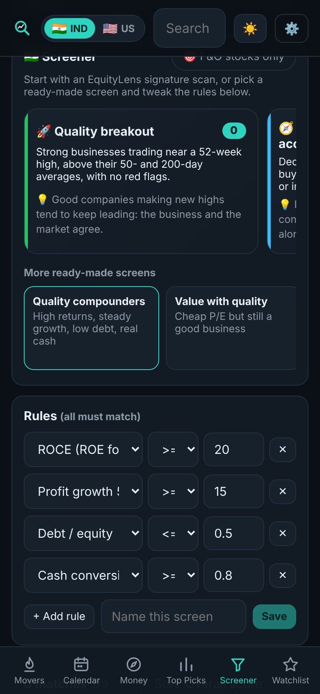<br/><b>🧮 Screener</b></td>
</tr>
<tr>
<td align="center">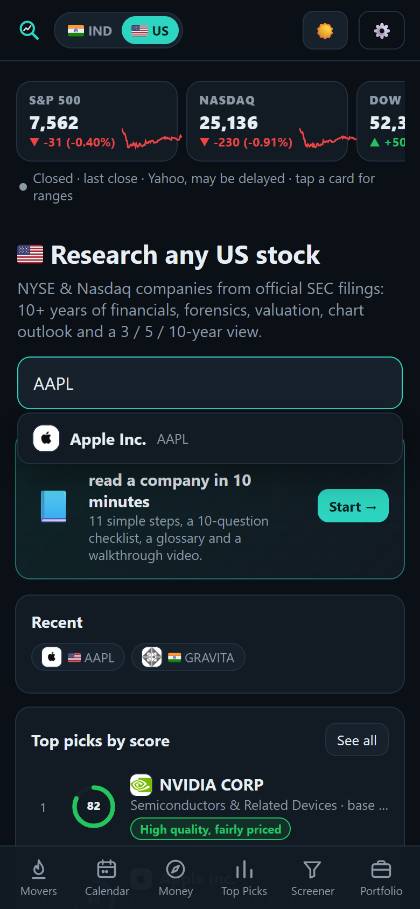<br/><b>🇮🇳 / 🇺🇸 one-tap market switch</b></td>
<td align="center">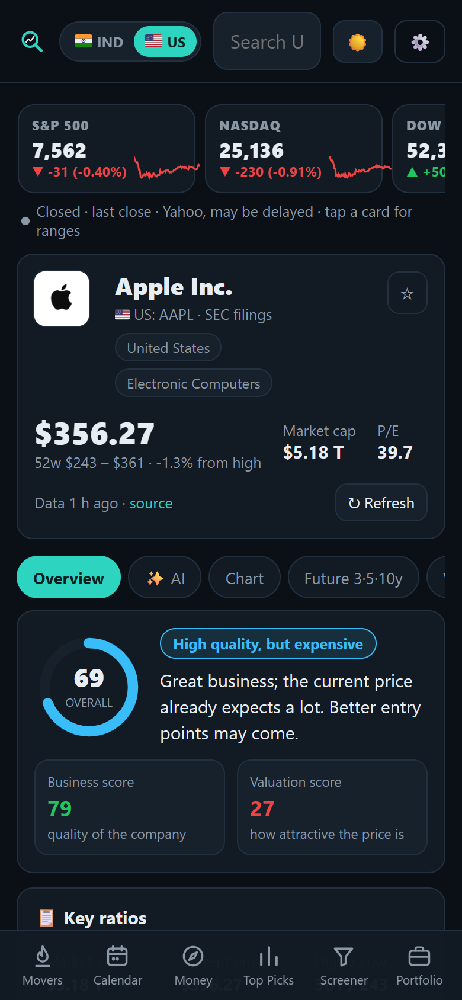<br/><b>🇺🇸 US stock in $ (SEC filings)</b></td>
<td align="center">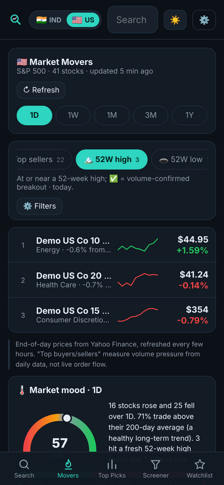<br/><b>🇺🇸 US movers: 52-week highs</b></td>
</tr>
<tr>
<td align="center"><br/><b>🔥 Top gainers this week</b></td>
<td align="center">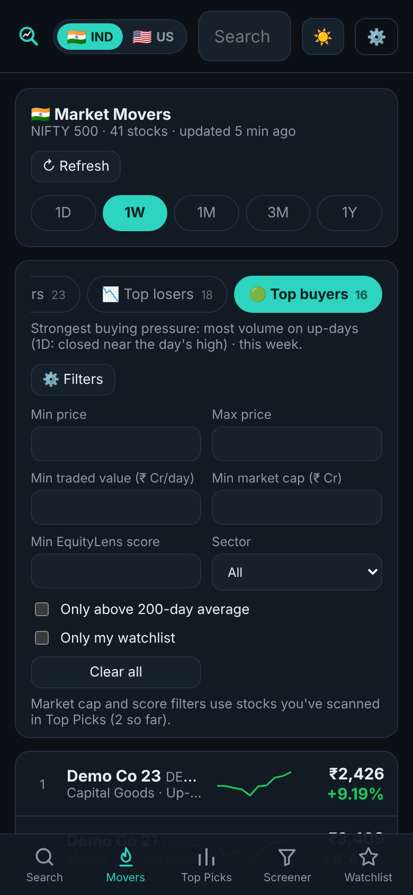<br/><b>🟢 Top buyers + filters</b></td>
<td align="center">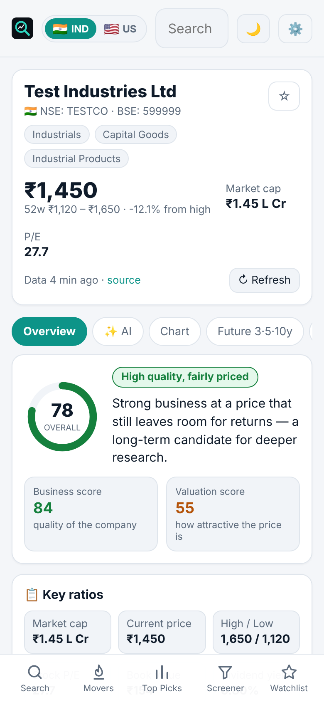<br/><b>☀️ Light theme</b></td>
</tr>
</table>

<sub>Screenshots use built-in sample companies (demo mode, offline AI). Real stocks show live numbers.</sub>

---

## 🇮🇳 / 🇺🇸 Two markets, one app

Tap **🇮🇳 IND** or **🇺🇸 US** at the top. Search, Top Picks and Screener switch to that market; every stock page works the same way.

| | 🇮🇳 India | 🇺🇸 United States |
|---|---|---|
| Stocks | NSE & BSE | NYSE & Nasdaq (every SEC filer) |
| Fundamentals | screener.in public pages | **SEC EDGAR**: official 10-K / 10-Q XBRL filings, free |
| Prices & chart | Yahoo Finance | Yahoo Finance |
| Money shown in | ₹ crore | US$ million (per-share in $) |
| Top Picks scan | NIFTY 500 | S&P 500 |
| Reports tab & AI reader | Annual reports, concalls, announcements | 10-K, 10-Q, 8-K filings |
| Ownership | Promoter / FII / DII trend | Not reported the same way, so ownership is left out of the score |
| Peers | Source's peer group | Same-industry companies from your S&P 500 scan |

> [!TIP]
> For US stocks the SEC asks every user to identify themselves. Put your name and contact in `backend/.env`
> as `EQL_SEC_USER_AGENT` (see `backend/.env.example`). It's only sent to sec.gov.

---

## ✨ Everything on a stock page

| | Tab | What's inside |
|:-:|---|---|
| 🟢 | **Overview** | Verdict & score ring · key ratios · latest quarter (YoY / QoQ + 8-quarter chart) · 3/5/10-year stance · scorecard · strengths ✅ & red flags 🚩 · fair value & forensic quick checks · company key points |
| ✨ | **AI** | 🧠 Research note · 💬 ask-anything chat · 🎯 management guidance check · ⚔️ bull vs bear debate with a ⚖️ judge · 📄 annual report & concall reader |
| 📈 | **Chart** | Candles (daily/weekly, 3M–10Y) · EMA 20/50/200 · Bollinger · Supertrend · golden/death crosses · support/resistance · volume · RSI · MACD · ADX · signal checklist |
| 🔭 | **Chart outlook** | Plain-English chart story · 🎯 if/then levels · 📐 likely price range (drawn on the chart) · 📜 what happened after the same setup before · ✨ AI chart explainer |
| 🔮 | **Future 3·5·10y** | Bear / base / bull price and yearly return · reverse DCF · every assumption visible |
| 💰 | **Valuation Lab** | Fair-value range (DCF, Graham, own median P/E, peer P/E, justified P/B) · **DCF sliders** · sensitivity grid · P/E bands · EV/EBITDA · 🏁 peer ranking · peers table |
| 🕵️ | **Forensics** | Piotroski F (9 tests, lender-adapted for banks) · Altman Z · Beneish M · DuPont ROE breakdown · accounting checks |
| 📊 | **Financials** | 📖 10-year story timeline · 10–12 years of P&L, balance sheet, cash flow, ratios, quarters, with charts |
| 🏭 | **Quality** | ROCE trend · profit vs operating cash · free cash · working-capital days |
| 👥 | **Ownership** | Promoter / FII / DII / public trend, quarter by quarter |
| 💹 | **Price** | 10-year price with 200-day average, price CAGR |
| 📄 | **Reports** | Annual reports, concall transcripts & PPTs, announcements, credit ratings |

### 🔥 Market Movers (🇮🇳 NIFTY 500 · 🇺🇸 S&P 500)

Pick a timeframe, **1D · 1W · 1M · 3M · 1Y**, and every list re-ranks for it.

| List | What it shows |
|---|---|
| 🚀 **Top gainers** / 📉 **Top losers** | Biggest price rise / fall over the timeframe |
| 🟢 **Top buyers** / 🔴 **Top sellers** | Strongest buying / selling **pressure**: share of volume traded on up-days vs down-days (1D: where it closed in the day's range). Tags *only buyers / only sellers* when it closed at the high / low |
| 🏔️ **52W high** / 🕳️ **52W low** | New or near 52-week highs / lows; ✅ marks **volume-confirmed breakouts** |
| 🔊 **Volume shockers** | Volume far above its normal (relative volume) |
| 💰 **Most active** | Highest traded value (₹ Cr / $ M per day) |
| 💎 **Quality on sale** | Business score ≥ 70 but 15%+ below its 52-week high |
| ⚠️ **Hype watch** | Top-20% risers with a weak business score or red flags |

- 🌡️ **Market mood gauge** (Extreme fear → Extreme greed) built from advances/declines, % above 50 & 200-day average, 52W highs vs lows and the median move, with a one-paragraph read
- 🗺️ **Sector heatmap**: average move of each sector, tap a sector to filter every list
- ⚙️ **Filters**: price range, minimum traded value, market cap, EquityLens score, sector, only above 200-day average, only my watchlist
- ✨ **Explain the move**: the AI agent reads the leaders and laggards and writes why they moved and what to check
- Daily prices from Yahoo's public chart feed, refreshed every few hours in the background. *Buyers/sellers are measured from daily volume, not live order flow.*

### 🏆 Top Picks · 🧮 Screener · ⭐ Watchlist · ⚖️ Compare

- 🏆 **Top Picks:** scans the whole **NIFTY 500** 🇮🇳 or **S&P 500** 🇺🇸 and ranks every company by the same rules, plus ✨ "explain this list with AI"
- 🧮 **Screener:** 9 ready-made screens and your own rules on **45+ fields**, saved on your phone
  > 💎 Quality compounders · 🏷️ Value with quality · 📉 Below fair value · 🏦 Holding-company discount · 🧱 Debt-free growers · 🚀 Piotroski 8+ · 🤝 Promoters buying · ⏳ Cheap vs own history · 🌳 10-year compounders
- ⭐ **Watchlist** and ⚖️ **Compare up to 4 stocks** side by side

---

## 🤖 AI agents (Claude · ChatGPT · Gemini · Ollama)

| | Agent | What it does |
|:-:|---|---|
| 🧠 | **Research note** | Full write-up: quality, growth, balance sheet, forensics, valuation, 3/5/10-year view, risks, what to watch |
| 💬 | **Ask about this stock** | Chat grounded in that stock's own data: *"Is the debt a worry?"*, *"Why did margins fall?"* |
| 🎯 | **Guidance check** | Takes every target management has set and grades it against the track record: ✅ achievable · ⚠️ stretch · ❌ unlikely |
| ⚔️ | **Bull vs Bear debate** | Two agents argue for and against, a judge checks both against the data |
| 📄 | **Report reader** | Reads annual reports and concall transcripts: guidance, capex, risks, tone |
| 📈 | **Chart explainer** | Explains the chart, the levels that matter and what history says |
| 🏆 | **Explain my list** | Why each Top Pick / Screener result ranks, and what they have in common |

Choose the provider in **⚙️ Settings** (top-right):

| Provider | Cost | Notes |
|---|---|---|
| **Claude** | Pay per use | Best for long reports. Sonnet / Opus / Haiku selectable |
| **ChatGPT** | Pay per use | Any chat model name from your OpenAI account |
| **Gemini** | Free tier + paid | Tap *Load my models* to pick from the models your key can use |
| **Ollama** | Free | Runs on your laptop; slower, less sharp |
| **Demo** | Free | Offline sample answers to try the screens |

> [!IMPORTANT]
> The AI only sees EquityLens's data for that stock and is told never to invent numbers. Keys stay on your laptop (`backend/data/ai_settings.json` or `backend/.env`, both git-ignored).

---

## 🚀 Quick start (Windows)

> [!TIP]
> **One click:** double-click **`start.bat`**. The first run creates `backend/venv`, installs 6 small packages and opens **http://localhost:8600**.

```bat
git clone https://github.com/dhanunjaya-kd/equitylens
cd equitylens
start.bat
```

<details>
<summary>🛠️ <b>Manual setup</b></summary>

```bat
cd backend
py -3.11 -m venv venv
venv\Scripts\activate
pip install -r requirements.txt
REM run once: checks live data end to end
python selftest.py
python run.py
```
</details>

### ✅ First things to do

| # | Do this | Why |
|:-:|---|---|
| 1️⃣ | `python selftest.py` in `backend/` | Fetches RELIANCE, HDFCBANK, ITC and Apple (US) live and prints what was read |
| 2️⃣ | Search any stock in the app | Full report in ~5 s, cached for 24 h (↻ Refresh fetches new data) |
| 3️⃣ | ⚙️ Settings → pick an AI provider | Claude / ChatGPT / Gemini key, or Ollama for free |
| 🇺🇸 | Add `EQL_SEC_USER_AGENT` to `backend/.env` | Needed once for US stocks (SEC rule) |
| 4️⃣ | Top Picks → **Quick scan (30)** | See the ranking work in ~3 min (in whichever market is selected) |
| 5️⃣ | Top Picks → **Scan NIFTY 500 / S&P 500** | Full ranking in ~30–60 min. Re-run weekly or after results season |
| 🔥 | Open **Movers** | First load downloads daily prices for the index (~3–5 min), then refreshes in the background every few hours. Run the Top Picks scan too so *Quality on sale* / *Hype watch* and the score filter have fundamentals to use |
| ☀️ | Tap ☀️ / 🌙 (top bar on phone, sidebar on laptop) | Switch light / dark theme; your choice is remembered |

### 🖥️ Use it on your laptop

Open **http://localhost:8600** in Chrome or Edge. On screens wider than ~1100 px EquityLens switches to the **web layout**:
a left sidebar (with the 🇮🇳/🇺🇸 switch), a wide search bar, two-column stock pages, a taller chart and a full ranking table.

### 📱 Use it on your phone

1. Keep the laptop on with Tailscale running
2. On the iPhone open `http://<laptop-tailscale-ip>:8600`
3. Share → **Add to Home Screen** and it opens like an app

---

## 🧭 How it works

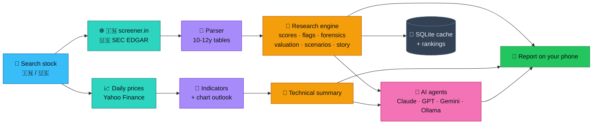

### 🚦 Verdicts

| | Verdict | Meaning |
|:-:|---|---|
| 🟢 | **High quality, fairly priced** | Strong business, price still leaves room for returns |
| 🔵 | **High quality, but expensive** | Great business, price already expects a lot |
| 🔵 | **High quality, price data missing** | Strong business; valuation couldn't be checked |
| 🟡 | **Average — keep on watch** | Mixed picture, track it |
| 🟠 | **Good numbers, serious red flags** | Check the flags before trusting the scores |
| 🔴 | **Weak — avoid for now** | Fundamentals or red flags argue against holding |
| ⚫ | **Loss-making — speculative** | No current earnings, a turnaround bet |
| ⚪ | **Not enough data** | Under 3 years of usable numbers: not rated, not ranked |

<details>
<summary>📐 <b>Scoring rules (all visible in the app)</b></summary>

<br/>

| Score (0–100) | Built from |
|---|---|
| 🌱 Growth | 5-yr profit & sales CAGR, years of profit growth |
| 🏭 Quality | ROCE 5-yr average (ROE for banks), margin stability |
| 🛡️ Strength | Debt/equity, interest coverage (equity/assets for banks) |
| 💵 Cash | Operating cash ÷ profit, free-cash years (skipped for banks) |
| 👥 Ownership | Promoter level & trend, FII+DII trend, pledging |
| 🏷️ Valuation | P/E, PEG, P/E vs own 10-yr median, P/B for banks |

**Business** = first five · **Overall** = 80% business + 20% valuation

**Future scenarios:** start from last-12-month EPS → grow at a blend of 3/5/10-yr profit growth (capped at sales growth + 5 and at 25%) → growth fades to 4 / 8 / 11% by year 10 (bear / base / bull) → P/E starts at the 10-yr median and drifts toward 12–25. Returns include the dividend yield.

**Chart outlook:** the likely range uses the stock's own last-year volatility with no direction assumed. "Same setup before" finds every past day with the same trend & momentum state (price vs 200 EMA, 50 vs 200 EMA, RSI zone, MACD vs signal) and measures where the price was 1, 3 and 6 months later, compared with an average day.
</details>

<details>
<summary>⚙️ <b>Settings (environment variables)</b></summary>

| Variable | Default | What it does |
|---|---|---|
| `EQL_REQUIRED_RETURN` | `0.12` | Target yearly return used in reverse DCF and default DCF |
| `EQL_FAIR_EXIT_PE` | `20` | Exit P/E for reverse DCF |
| `EQL_CACHE_TTL_HOURS` | `24` | How long a fetched stock is reused |
| `EQL_SCAN_DELAY` | `3` | Seconds between companies in a scan (keep it polite) |
| `EQL_PORT` | `8600` | Web port |
| `EQL_AI_PROVIDER` | `claude` | `claude` · `openai` · `gemini` · `ollama` · `demo` |
| `EQL_SEC_USER_AGENT` | — | Your name + contact for SEC EDGAR (US stocks) |
| `EQL_DEMO` | `0` | `1` = offline demo with sample companies **TESTCO**, **TESTBANK** and 🇺🇸 **TSTUS** |

AI keys and models: see `backend/.env.example`, or just use ⚙️ Settings.
</details>

---

## 🧪 Quality checks

```bat
cd backend
python run_tests.py
```

| Suite | What it proves |
|---|---|
| `test_engine.py` | Parser reads the source's table layout; scores, flags, forensics, valuation and indicator maths (EMA, RSI, MACD, ADX checked against reference formulas) |
| `test_stress.py` | 12 broken / partial-data cases (no cash flow, 2 years only, negative equity, all losses, no price…) never crash and are never over-rated |
| `test_api.py` | Every endpoint, including error paths: bad symbols, missing keys, blocked document links |
| `test_ai.py` | Exact request format for Claude, OpenAI, Gemini and Ollama; friendly errors; masked keys; every AI feature end to end |
| `test_us.py` | SEC filings read correctly: revenue tag changes merged, 6/9-month YTD figures ignored, Q4 derived, TTM, ratios, $ throughout |
| `test_movers.py` | Returns per timeframe, buying/selling pressure, turnover in ₹ Cr / $ M, relative volume, 52W breakouts, mood score, sector heatmap, both markets |

---

## 🗂️ Project structure

```
equitylens/
├── 🟦 start.bat              one-click start (Windows)
├── 🐍 backend/
│   ├── app/
│   │   ├── scraper.py        🇮🇳 public-page fetcher (paced, retries, cached)
│   │   ├── us.py             🇺🇸 SEC EDGAR → same tables (10-K/10-Q, TTM, Q4, filings)
│   │   ├── money.py          ₹ Cr / $ M currency context
│   │   ├── parser.py         HTML → clean tables, key points, peers, documents
│   │   ├── analysis.py       metrics, scores, flags, scenarios, verdict, 10-year story
│   │   ├── forensics.py      Piotroski · Altman · Beneish · DuPont
│   │   ├── valuation.py      DCF · Graham · P/E bands · EV · fair value
│   │   ├── technicals.py     OHLC + indicators + chart outlook (range, analogs, levels)
│   │   ├── ai.py             Claude / OpenAI / Gemini / Ollama agents
│   │   ├── movers.py         market movers, pressure, mood gauge, sector heatmap
│   │   ├── service.py        fetch → cache → analyse, NIFTY 500 scan
│   │   └── main.py           API + serves the web app
│   ├── static/               prebuilt app (no npm needed to run)
│   ├── tests/                47 offline tests + sample Indian & US company data
│   └── run.py · scan.py · selftest.py · run_tests.py
├── ⚛️ frontend/              React source (npm install && npm run build)
└── 🖼️ docs/                  banner + screenshots
```

---

## 🛣️ Roadmap

- [ ] ☁️ Cloud version (Vercel + free database + weekly GitHub Actions scan) so it works with the laptop off
- [ ] 🔔 Alerts when a watchlist stock crosses a level or its verdict changes
- [ ] 💼 Portfolio X-ray: your holdings scored together
- [ ] 🗂️ Score history: how a company's scores changed quarter by quarter

---

> [!NOTE]
> Indian fundamentals come from the same public company pages you'd open in a browser (screener.in), US fundamentals from the SEC's official EDGAR filings, and chart prices from Yahoo Finance's public chart feed. No logins or paid data. If a site changes its layout, `selftest.py` shows exactly which section broke. Keep the app on your own network (Tailscale) rather than exposing port 8600 to the internet, since Settings can change AI keys.

> [!WARNING]
> Everything is built from **past numbers and stated assumptions**. EquityLens is a research aid, **not investment advice**. Read the red flags and the company's own annual report before investing.

<div align="center">
<br/>

Made with 💚 for long-term investing

</div>
